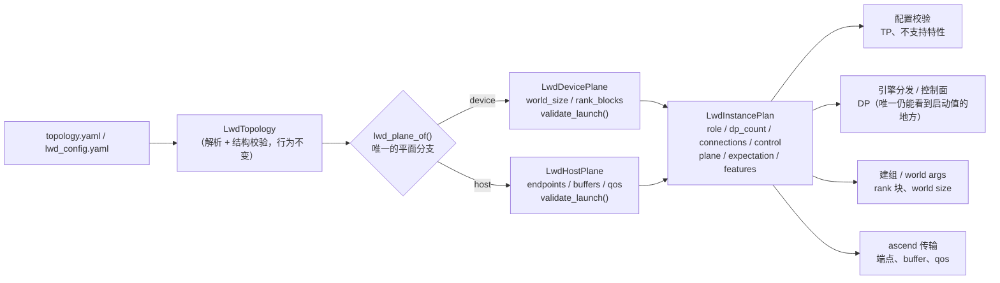

# LWD 配置事实与实例计划设计

> **评审请求**：批准引入"数据面判别联合 + 实例计划（`LwdInstancePlan`）"，把 LWD 的派生配置事实与并行期望收敛成一份不可变数据，让各校验执行点只做"取用 + 比较"，不再各自推导、各自判断平面。
> **改动面**：`vllm/config/lwd/`（新增 `layout.py`，改 `entry.py` / `topology.py`）、`vllm/distributed/lwd/lwd_parallel_groups.py`、`vllm/distributed/parallel_state.py`、`vllm/v1/lwd_control/lwd_comm/lwd_control_plane_factory.py`、`vllm/v1/engine/core.py`；`vllm-ascend`（`host/lwd_host_channels.py`、`lwd_base_model/lwd_worker_base.py`）。vllm 8 文件 +497/−126、vllm-ascend 3 文件 +27/−34（含单测）。
> **主要风险**：纯重构的等价性——搬动取值来源时改变某条校验的结论或报错文案（有测试与日志分析工具依赖文案）。
> **怎么验**：现有拓扑矩阵（单/多边、单/多云、`edge_share`）× device/host × 角色 的"重构前后结论一致"对照 + 单测；无需真机。
> **未决**：0 项（Q1–Q4 已在评审中定案，见 §5.2 评审决议）。
>
> 状态：已实现（分支 `refactor/lwd-config-plan`，PR vllm-data-comm/vllm#76、vllm-data-comm/vllm-ascend#48）｜基线：vllm `7192950f28`、vllm-ascend `63f1270b01`（`feat/lwd-host-multi-edge`）｜作者：待填

## 1 背景

### 1.1 现状

LWD 的配置校验分散在五个执行点，每个执行点都从拓扑重新推导自己需要的事实：

| 执行点 | 入口 | 它推导的事实 / 负责的规则 |
| --- | --- | --- |
| 解析期 | `LwdTopology.validate_layout`（`vllm/config/lwd/topology.py:335`） | 结构、scene、ctrl_port、ranks/端口（按平面分叉） |
| 配置期 | `lwd_check_parallel_config`（`vllm/distributed/lwd/lwd_parallel_groups.py:161`） | 不支持的并行特性、device 的 TP vs rank 块；host 分支只跳过 device 检查 |
| 引擎分发 | `EngineCoreProc`（`vllm/v1/engine/core.py:1336-1349`） | DP 与角色（edge=1、cloud=len(dp)），两种平面相同 |
| 控制面 | `_lwd_validate_dp`（`vllm/v1/lwd_control/lwd_comm/lwd_control_plane_factory.py:48`） | DP 与角色（同上，用启动时捕获的值再查一次） |
| 建组/worker | `_lwd_world_args`（`parallel_state.py:2316`）、ascend `host/lwd_host_channels.py:306`、`lwd_cloud_worker.py:79`、`lwd_cloud_model_runner.py:134` | rank 块、world size、连接端点、buffer；V4 Hash / V1 runner 两条功能约束仍在这一层 |

审计时按"是否依赖 `data_plane_comm`"分类：10 条已统一、6 条该统一却散落、device 专属 7 条、host 专属 5 条（本期处理后的归属见附录 B）。

### 1.2 痛点

**P1（已发生的漂移，也是本次设计的直接动因）：同一条 DP 规则曾在三处取舍。**
host 分支曾要求 `data_parallel_size == len(instance.dp)`（旧 `lwd_parallel_groups.py:201`），对 edge 判错；修复提交 `7192950f28` 把它从配置期移到了引擎分发与控制面。原因写在现在的注释里（`lwd_parallel_groups.py:196-203`）：non-MoE DP 引擎会在建引擎前把 `data_parallel_size` 重置为 1，且 vLLM 之后会用重置后的对象 `replace` 重建派生配置（如 MTP draft config），**在配置对象上校验 DP 会拒绝合法启动**。

这条历史说明：**"在哪校验"由取值生命周期决定，不由规则本身决定**。因此正确的抽象不是"把所有校验收进一个函数"，而是"把所有事实与期望收进一份数据，各执行点在还能看到值时取用"。

**P2（可维护性）：平面判断散布。**
`is_host_comm` 至少出现在拓扑校验（`topology.py:364`）、配置校验（`lwd_parallel_groups.py:204`）、队列选择与 ascend 传输初始化中；每加一处校验就多一次分叉。

**P3（重复推导）：每个执行点各取一份事实。**
`len(lwd.instance.dp)` 在引擎分发与控制面各算一次；rank 块在 `parallel_state.py:2316` 单独取；ascend 侧再自己走一遍 `lwd_config.connections` 与 `deployment.data_plane_host`（`lwd_host_channels.py:138-144`）。加一个消费者就多一处漂移点。

**P4（结构性）：类型没有表达"两种平面互斥"。**
`LwdDeployment` 同时持有 `hccl_world_size` 与 `data_plane_host`（`topology.py:96-107`），`LwdDP.ranks` 是"device 必填、host 必须缺省"（`topology.py:218-226`）。于是每条"必填/禁止"只能写成运行时 `raise`（`_validate_ranks` / `_validate_host_layout` 合计十余条）。

### 1.3 为什么现在做

校验执行点从 4 个增加到 5 个（DP 修复新增引擎分发），每一次新增都要重新推导事实、重新判断平面；host 多边多云与多 DP 还需要这些事实保持稳定。趁执行点还少、行为已有测试锁定，做结构收敛的代价最小。

## 2 目标

### 2.1 一句话目标

把"派生事实与并行期望"收敛成一份不可变数据（`LwdInstancePlan`），平面判断收敛到一个工厂（`lwd_plane_of()`），各执行点从"自己推导 + 自己判断平面"变成"取字段 + 比较"，且**不改变任何校验结论与报错文案**。

### 2.2 可验收判据

- **G1**：校验路径（`config/lwd/*`、`distributed/lwd/lwd_parallel_groups.py`、`v1/lwd_control/*`、`v1/engine/core.py` 的 LWD 段）内不再出现 `is_host_comm`；平面判断只出现在 `lwd_plane_of()` 与"运行期选择传输实现"两处，后者消费 `LwdPlane` 类型而不是配置字符串。
- **G2**：`len(instance.dp)`、rank 块、`hccl_world_size`、连接端点、`data_plane_host` 的读取都改为 `plan` 字段；上述执行点内不再出现 `lwd_config.instance.dp` / `deployment.hccl_world_size` / `lwd_config.connections` 的直接推导。
- **G3**：DP 与 TP 的期望值各只在一处计算；引擎分发、控制面、配置校验三处只传入自己的实际值做比较。
- **G4**：与平面无关的功能约束有唯一归属：加扰因子进 `plan.check_features`，worker 删除重复判断。V4 Hash 与 V1 runner 的校验本期留在 ascend（见非目标），不重复实现。
- **G5（等价性）**：对现有全部拓扑与启动组合，校验结论（异常类型与文案）与重构前逐条一致；`tests/distributed/test_lwd_parallel_groups.py` 现有用例全绿。文案若需统一，另开改动。

### 2.3 非目标

- **不把 DP 校验搬到配置期**：已由 `7192950f28` 证明不可行（non-MoE DP 引擎重置 `data_parallel_size`，派生配置会重建），DP 继续留在引擎分发与控制面，本设计只把它的期望值来源收敛到 `plan`。
- **V4 Hash 与 V1 runner 的校验暂不搬家**：V4 Hash 依赖 ascend 的 `hash_layer_count()`（`vllm_ascend/worker/lwd_hash/lwd_hash_routing.py:7`）；V1 runner 的 `use_v2_model_runner` 会解析平台并可能抛错，不适合在 `VllmConfig.__post_init__` 里求值。两者留在 ascend，规则不变（Q2 保持一刀切）。
- **不改任何校验结论与文案**：文案被测试与 `log_analyze_tools` 解析，统一文案会破坏 G5；需要时另开。
- **不改 YAML schema**：判别联合只在解析之后构建，用户契约不变。
- **保留 `enable_early_recv`**（Q1 决议）：它当前不改变任何行为（`topology.py:150`，两仓无消费者），本次不接线、不删除，只补注释说明"保留未接线"，schema 不变。
- **不改 host 传输实现**：UCX 链路、buffer 推导、daemon 模式不动，只搬"读配置"的位置。

## 3 设计

### 3.1 总体方案



一句话：**拓扑只解析一次、平面只判断一次，五个执行点共用同一份 `plan`；每个执行点只比较自己"仍然看得到"的值。**

### 3.2 关键决策

#### D1 用判别联合表达两种平面

- **问题**：`LwdDeployment` 把 `hccl_world_size` 与 `data_plane_host` 平铺在一起，`LwdDP.ranks` 也一样（P4），导致"必填/禁止"只能运行时校验，且每个下游都要再分叉（P2）。
- **方案**：解析后投影成判别联合，构造时完成平面专属校验：

```python
@dataclass(frozen=True)
class LwdDevicePlane:
    hccl_world_size: int
    rank_blocks: Mapping[LwdConnectionId, tuple[int, ...]]
    def validate_launch(self, vllm_config: "VllmConfig") -> None: ...

@dataclass(frozen=True)
class LwdHostPlane:
    endpoints: Mapping[LwdConnectionId, LwdHostEndpoint]   # cloud addr + data_port
    buffers: LwdHostDataPlane
    qos: LwdQosDataPlane
    def validate_launch(self, vllm_config: "VllmConfig") -> None: ...

LwdPlane = LwdDevicePlane | LwdHostPlane

def lwd_plane_of(topology: LwdTopology) -> LwdPlane:
    """Build the plane the deployment actually uses; the only place that
    dispatches on data_plane_comm."""
```

- **为什么可行**：两种平面的字段集合互不相交（device 只有 rank/world，host 只有 endpoint/buffer/qos），投影是纯函数；非法组合（host 里出现 ranks）在构造期即被拒绝，不可能流入下游。
- **否决的备选**：把 YAML 也改成嵌套判别联合。用户契约与 `gen_lwd_topology.py` 要同步迁移并兼容两种写法，收益（少一次投影）远小于成本。

#### D2 计划暴露期望值，执行点在"值仍然有效处"比较

- **问题**：P1 说明执行点由取值生命周期决定；P3 说明现在每个执行点都在重复推导。
- **方案**：`plan` 只提供**事实与期望值**，不提供"统一抛错入口"；各执行点保留自己的校验位置与文案，只把输入换成 `plan`：

```python
@dataclass(frozen=True)
class LwdParallelExpectation:
    data_parallel_size: int              # edge=1, cloud=len(instance.dp)
    tensor_parallel_size: int | None     # device=rank 块大小；host=None（启动期不约束）
```

- **为什么可行**：三个执行点各比较自己仍能看到的那一个值——配置期比 TP（`data_parallel_size` 已被重置，读不得）、引擎分发与控制面比 DP——但期望值只有这一份，不会像以前那样在调用点各算一遍。
- **否决的备选**：把 DP/TP 校验合并进 `lwd_check_parallel_config` 一个函数。`7192950f28` 已验证配置期拿不到稳定的 DP 值，合并会拒绝合法启动。

#### D3 `LwdInstancePlan` 作为唯一事实源

- **问题**：`len(instance.dp)`、rank 块、端点、buffer 在各处重复取（P3）。
- **方案**：不可变对象，缓存在 `LwdConfig.plan`：

```python
@dataclass(frozen=True)
class LwdInstancePlan:
    role: str
    instance_id: int
    dp_count: int
    connections: tuple[LwdDPConnection, ...]   # 复用 LwdConfig.connections 的 scene 语义
    plane: LwdPlane                             # LwdDevicePlane | LwdHostPlane
    expectation: LwdParallelExpectation
    world_size: int | None                      # device: hccl_world_size；host: None
    rank_blocks: tuple[tuple[int, ...], ...] | None   # device: 本实例每个 DP 的 rank 块
    @classmethod
    def from_config(cls, lwd_config: LwdConfig) -> "LwdInstancePlan": ...
    def check_parallel(self, parallel_config) -> None: ...
    def check_features(self, vllm_config) -> None: ...
```

消费方与它取用的字段：

| 消费方 | 取用 |
| --- | --- |
| `lwd_check_parallel_config` | `expectation.tensor_parallel_size`、`check_features()`、`plane.validate_launch()` |
| `EngineCoreProc` / `_lwd_validate_dp` | `expectation.data_parallel_size`、`dp_count` |
| `_lwd_world_args` | `world_size`、`rank_blocks[data_parallel_index]` |
| `parallel_state` 的建组判据 | `plan.is_host` |
| ascend `lwd_host_channels` | `connections`、`plane.endpoints`、`plane.buffers`、`plane.qos` |

- **为什么可行**：所有字段由拓扑与角色唯一确定；`frozen` 保证多线程只读；`connections` 直接复用 `LwdConfig.connections`（`entry.py:85-95`），不重写 `edge_share` 特例。
- **否决的备选**：继续传 `LwdConfig` 让每个消费者自己推导——这正是 P3 的成因。

#### D4 平面专属校验多态化

- **问题**：`_validate_ranks` / `_validate_host_layout`（`topology.py:425-476`、`372-410`）与 `lwd_check_parallel_config` 的 host 分支（`lwd_parallel_groups.py:204-207`，当前只剩跳过 device 检查）都用 `if is_host_comm` 切分（P2）。
- **方案**：两条 `_validate_*` 的实现整体搬进 `LwdDevicePlane.from_topology()` / `LwdHostPlane.from_topology()`（文案不变），`validate_layout()` 改为调用 `lwd_plane_of(self)`；`lwd_check_parallel_config` 只保留"不支持的并行特性"（公共）与 `plan.plane.validate_launch(vllm_config)`。
- **为什么可行**：每条平面专属规则只依赖本平面的字段（device 的 world/ranks，host 的端口/buffer），放进对应类型后没有跨平面分支；`validate_launch` 拿到完整 `VllmConfig`，可继续用现有文案与检查顺序。
- **否决的备选**：保留两个 `_validate_*` 方法，只在内部改用 `plane` 字段。分叉仍在，G1 无法满足。

#### D5 与平面无关的功能约束上移

- **问题**：V4 Hash 的并行约束（`lwd_cloud_model_runner.py:134`）、V1 runner 要求（`lwd_cloud_worker.py:79`）、加扰因子（`lwd_worker_base.py:43`）与平面无关，却写在 ascend 的 worker/runner 里，报错晚于配置阶段（P3）。
- **方案**：本期只把**加扰因子**搬进 `plan.check_features(vllm_config)`，worker 删除重复判断。V4 Hash 与 V1 runner 留在 ascend（非目标里给了原因），等各自的前置条件具备再搬；V4 Hash 按 Q2 决议**保持一刀切**，不按平面放宽。
- **为什么可行**：加扰规则的输入完全在 `LwdConfig` 内；`check_features` 与 `lwd_check_parallel_config` 同一个调用路径（`vllm/config/vllm.py:1297-1299`），报错时机前移但结论不变（G5 允许"时机前移"，文案保持）。
- **否决的备选**：留在 worker/runner，配置层再加一份。会形成两份规则，迟早不一致。

### 3.3 接口 / 数据 / 配置变更

| 变更 | 作用 | 位置 | 兼容性 |
| --- | --- | --- | --- |
| 新增 `LwdPlane` / `LwdDevicePlane` / `LwdHostPlane` / `lwd_plane_of()` | 把"这次部署用哪种平面"收敛成一次判断；下游按类型分派，不再读 `data_plane_comm` 字符串，两种平面的字段互斥由类型保证 | `vllm/config/lwd/layout.py`（新） | 纯新增 |
| 新增 `LwdInstancePlan`、`LwdParallelExpectation` | 每进程一份事实与期望：DP/TP 期望、rank 块、世界大小、端点都从这里取，执行点不再各算一遍 | 同上 | 纯新增 |
| 新增 `LwdConfig.plan` 缓存属性 | 计划只构造一次即被所有消费者共享；构造时顺带完成平面校验，解析期的报错时机不变 | `vllm/config/lwd/entry.py` | 纯新增 |
| `_validate_ranks` / `_validate_host_layout` 搬入两个平面构造 | 平面专属规则只依赖本平面字段；拓扑解析顺序与报错文案逐字不变，只是不再有 `if is_host_comm` | `vllm/config/lwd/topology.py` | 内部，文案不变 |
| `lwd_check_parallel_config` 的平面分支收敛为 `plane.validate_launch()` | 配置期只剩"公共不支持特性 + 平面钩子"；device 的 TP 判断改为对期望值，host 侧不再有分支 | `vllm/distributed/lwd/lwd_parallel_groups.py` | 签名不变，结论不变 |
| 引擎分发与控制面改读 `plan.expectation` | DP 规则仍留在"还能看到启动值"的位置执行，但期望值不再在两个调用点各推导一次 | `vllm/v1/engine/core.py`、`lwd_control_plane_factory.py` | 内部 |
| `_lwd_world_args` 从计划取 world size 与 rank 块；建组判据改读 `plan.is_host` | 全局 rank 映射与建组走同一份事实，避免两条路径各读一次拓扑；传输选择改按平面类型而非配置字符串 | `vllm/distributed/parallel_state.py` | 内部；`from_topology` 签名保留 |
| ascend 读 `plan` 而非重走 topology | host 链路、cloud 端点、buffer 与 qos 一次取齐；`edge_share` 的 connections 语义由计划复用，不再各自展开 | `host/lwd_host_channels.py` | 内部 |
| 加扰因子校验上移 | 配置阶段即拒绝"开启加扰但缺因子"，worker 只做绑定；启动失败更早，文案不变 | `vllm/config/lwd/layout.py`、ascend `lwd_worker_base.py` | 报错时机前移，文案不变 |
| 注释一致性修正（Q4 + 顺带）：`data_plane_host` 改为"可选，缺省用默认值"并修 UTF-8 乱码；`lwd_check_parallel_config` docstring 去掉"host edge TP 会被拒"；`enable_early_recv` 标注"保留未接线" | 让注释与实现一致：块可选、host TP 现在由运行期首次 UP submit 暴露、开关当前不接线，避免误导后续改动 | `vllm/config/lwd/topology.py`、`vllm/distributed/lwd/lwd_parallel_groups.py` | 仅注释，无行为变化 |
| YAML schema | 用户配置零迁移：判别联合只在解析之后构建 | 无变更 | 完全兼容 |

### 3.4 失败路径与降级

| 场景 | 系统行为 |
| --- | --- |
| 拓扑非法（rank 重叠、未覆盖 world、端口冲突） | `LwdTopology.from_dict` 抛出，与今天一致 |
| 平面字段互斥被破坏（host 带 ranks、device 带 `data_port`） | 投影期抛出；文案沿用现有 `_validate_*` 文本 |
| 不支持的并行特性 | 配置期 `NotImplementedError`，与今天一致 |
| device TP 与 rank 块不符 | 配置期 `ValueError`，文案不变 |
| host 模式 edge TP>1 | 不在启动期拒绝：首次 UP submit 因缺 IO 失败（`docs/design/lwd_host_data_plane.md:51`），本设计不改这一行为 |
| DP 与角色不符 | 仍在引擎分发与控制面抛（`7192950f28` 的位置），只换取值来源 |
| 加扰开启但缺因子 | 配置期 `ValueError`（原在 worker init），文案不变 |
| device 模式下写了 `qos.data_plane` | 启动时打 `[LWD]` warning 并忽略该块（Q3 决议），不拒绝，既有拓扑照常启动 |
| `lwd_config` 缺失却走 LWD 路径 | 保持现有 `assert`，不新增静默分支 |

### 3.5 影响面、兼容性、迁移与回滚

- **影响面**：仅 LWD 进程的启动路径；不涉及数据面协议、YAML 与公开构造方式。
- **提交拆分**（每步可独立编译、独立回归）：
  1. `refactor(lwd)`（vllm）：新增 `layout.py`（平面联合、计划、期望值）并接线（config check、engine dispatch、control plane、parallel_state），行为不变；
  2. `refactor(lwd)`（vllm-ascend）：host channels 改读计划，加扰校验上移后删除 worker 里的重复判断。
- **兼容性**：老 `topology.yaml` / `lwd_config.yaml` 全部可用；`lwd_check_parallel_config`、`LwdParallelGroupsSpec.from_topology`、`_lwd_validate_dp` 签名不变。
- **回滚**：两仓提交彼此独立、无数据/协议变更；回滚即 revert，无需开关。

## 4 验证

### 4.1 验收对照表

| 判据 | 证据 |
| --- | --- |
| G1 | 单测扫描校验路径源码无 `is_host_comm`；CI grep 检查 |
| G2 | 单测断言执行点不再访问 `lwd_config.instance.dp` / `deployment.hccl_world_size` / `lwd_config.connections`（源码扫描或 mock 计划对象） |
| G3 | DP/TP 期望值用例：同一拓扑下三个执行点读到的期望值一致 |
| G4 | 加扰缺因子在配置阶段抛错；worker 内不再有该判断（源码扫描） |
| G5 | 等价性矩阵：附录 B 的拓扑样例 × device/host × 角色，重构前后异常类型与文案逐一比对；现有 `tests/distributed/test_lwd_parallel_groups.py` 全绿 |

### 4.2 失败路径注入

- 拓扑矩阵：`device × host` ×（缺 ranks、多 `data_port`、端口冲突、rank 重叠）——断言与重构前相同的异常。
- 启动值矩阵：DP=1/2 × 角色 × 平面——断言引擎分发与控制面的结论不变。
- 计划构造注入：`data_plane_comm` 与字段组合矛盾（host 带 ranks、device 带 `data_plane_host`）。
- 这些用例全部可在 CI 无 NPU 环境运行（fake config + 直接调计划/校验函数）。

### 4.3 真机 / 性能

不改数据面与热路径，**无需性能验证**；只需 1E1C host 与 1E1C device 各一次启动冒烟，确认计划构造无回归。

### 4.4 未验证项与计划

- **真机启动冒烟待跑**：1E1C host 与 1E1C device 各一次启动尚未在本机执行（无 NPU），属 PR 前待补；判据是启动日志出现 `[LWD][config] resolved=...` 且无新增告警。
- 现网启动脚本依赖的报错文案：本设计承诺不变，但需在 PR 中贴出关键文案的 before/after（作者，PR 前）。
- 1E2C/2E2C 真机启动：本设计不改变启动判断，仍依赖既有 host 数据面验证（另行进行，不阻塞）。

## 5 风险与未决

### 5.1 风险

| 风险 | 最坏后果 | 缓解 | Owner |
| --- | --- | --- | --- |
| 搬动取值来源时改变结论或文案 | 现网启动脚本/日志分析工具失效 | 等价性矩阵 + before/after 文案对照 | 作者 |
| `LwdInstancePlan` 演变成"上帝对象" | 后续把业务逻辑塞进计划 | 只允许"派生事实 + 校验"，不承载运行时状态；ascend 只读字段 | 作者 + committer |
| 投影与原校验顺序不一致 | 错误顺序变化导致文案不同 | 保持每个执行点的检查顺序，仅替换取值 | 作者 |
| 循环依赖（config 层被 distributed 依赖） | 导入期失败 | 计划只依赖 `vllm/config/lwd/*`，`distributed`/`v1` 单向依赖它 | 作者 |

### 5.2 评审决议（原未决项，已定）

| # | 问题 | 决议 | 对设计的影响 |
| --- | --- | --- | --- |
| Q1 | `enable_early_recv` 当前无消费者（`topology.py:150`） | **保留**，不接线、不删除 | 非目标不变：只补注释说明"保留未接线"，schema 不变 |
| Q2 | V4 Hash 要求 `DP=PCP=DCP=1`（`lwd_cloud_model_runner.py:134`）在 host 多 cloud DP 下是否放宽 | **保持一刀切** | 该规则本期不搬家（仍在 ascend），不按平面放宽，语义不变 |
| Q3 | `qos.data_plane` 写在 device 模式下 | **告警**，不拒绝 | device 平面构造时打 `[LWD]` warning 并忽略该块，既有拓扑照常启动 |
| Q4 | `data_plane_host` 注释写"required"但实现全默认（`topology.py:104-106`），且该行有 UTF-8 损坏字符 | **改注释** | 注释改为"可选，缺省用默认值"并修乱码；`data_plane_host` 仍非必填 |

## 附录 A 新类型速查

| 类型 | 字段 | 用途 |
| --- | --- | --- |
| `LwdDevicePlane` | `hccl_world_size`, `instance_dp_ranks`, `dp_ranks_of()`, `validate_launch()` | device 平面的 rank 世界与告警 |
| `LwdHostPlane` | `endpoints`, `buffers`, `qos`, `endpoint_of()` | host 平面的监听端点与 buffer |
| `LwdParallelExpectation` | `data_parallel_size`, `tensor_parallel_size` | 并行期望值，执行点各取自己看得到的值 |
| `LwdInstancePlan` | `role`, `instance_id`, `dp_count`, `connections`, `plane`, `expectation`, `world_size`, `rank_blocks`；`is_host`、`check_parallel()`、`check_features()` | 每进程一份的事实源 |

## 附录 B 排查明细（本次审计结果）

**已统一（不动）**：PP/PCP/DCP/elastic EP/Engram 不支持（`lwd_parallel_groups.py:175-195`）；实例 ID 与 `dp_idx` 连续唯一；`instance_links` 合法性与去重（`topology.py:337-350`）；各实例 DP 数一致（`topology.py:360-363`）；scene 形状（`topology.py:490`）；coordination（`topology.py:412-423`）；`ctrl_port` 归属（`topology.py:351-357`）；同址 `ctrl_port` 不重复（`topology.py:478-488`）；API 选项（`LwdAPIConfig.validate_topology`）；**DP 与角色**（引擎分发 `engine/core.py:1336-1349` + 控制面 `lwd_control_plane_factory.py:48-69`，两种平面相同）。

**本期处理**：布局规则搬进 `layout.py` 的两个平面构造（文案不变）；加扰因子进 `plan.check_features`，worker 删除重复判断；`qos.data_plane` 在 device 下按 Q3 告警；`data_plane_host` 注释按 Q4 修正；`enable_early_recv` 按 Q1 保留并标注。

**本期不做（有原因）**：V4 Hash 并行约束（`lwd_cloud_model_runner.py:134`）依赖 ascend 的 `hash_layer_count()`；V1 runner 要求（`lwd_cloud_worker.py:79`）依赖会解析平台的 `use_v2_model_runner`，不适合在配置构造期求值。两者留在 ascend，规则按 Q2 保持不变。

**device 专属（归 `LwdDevicePlane`）**：`hccl_world_size` 必填、`ranks` 必填、edge 各 DP 共享 ranks/addr、cloud 均分 ranks、edge_share 共享 ranks、rank 覆盖 `[0, world_size)`，见 `layout.py` 的 `LwdDevicePlane.from_topology`；`TP == rank 块大小`（`lwd_parallel_groups.py` 经 `plan.check_parallel`，运行期 `parallel_state.py:2342-2353` 保留）。

**host 专属（归 `LwdHostPlane`）**：`ranks`/`hccl_world_size` 必须缺省、edge 禁 `data_port`、cloud 每 DP 必填 `data_port`、同址不重端口，见 `layout.py` 的 `LwdHostPlane.from_topology`；buffer 推导与端点由 ascend 从 `plan.plane` 读取（`lwd_host_channels.py`、`ucx_io`）。

host 模式 edge `TP>1` 不在启动期拒绝：首次 UP submit 因缺 IO 失败（`docs/design/lwd_host_data_plane.md:51`），本设计不改这一行为。

## 附录 C 评审记录

| 意见 | 提出人 | 处理 | 状态 |
| --- | --- | --- | --- |
| Q1 `enable_early_recv` | 评审 | 保留，不接线、不删除，只补"保留未接线"注释 | 已定 |
| Q2 V4 Hash 的 `DP=PCP=DCP=1` | 评审 | 保持一刀切，迁移时语义不变 | 已定 |
| Q3 `qos.data_plane` 写在 device 模式 | 评审 | 告警并忽略，不拒绝 | 已定 |
| Q4 `data_plane_host` 注释与乱码 | 评审 | 改注释为"可选，缺省用默认值"并修乱码 | 已定 |
