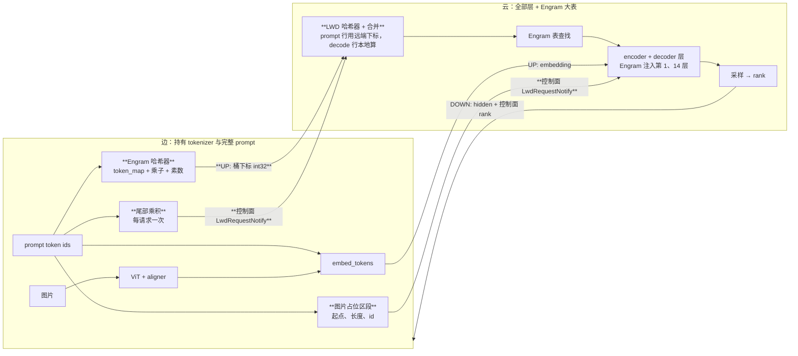
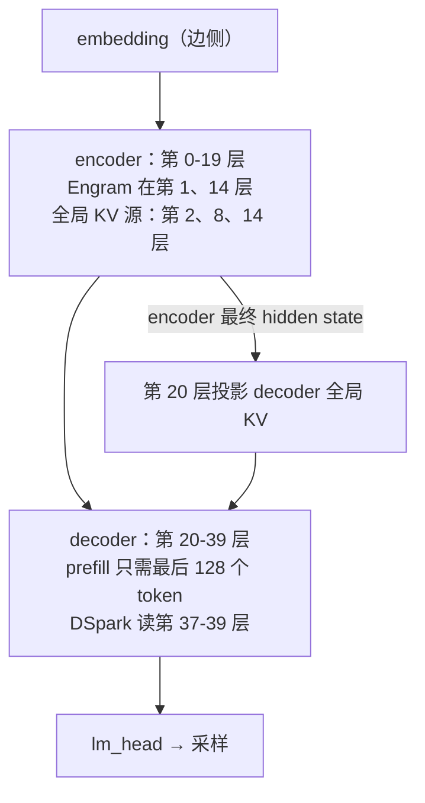

# LWD 适配 DeepSeek V4.1 设计（草案，待评审）

| 项 | 值 |
| --- | --- |
| 状态 | 草案，待与张晓枫评审后动工 |
| 任务来源 | 张晓枫 2026-10-19：① 分析原生 embedding 方案能否做 DSv4.1；② token 不能在边云之间传输，只能传向量或哈希 |
| 模型 | DeepSeek-V4.1-Flash；config、README、技术报告、官方 `inference/` 取自本地权重目录 |
| 基线 | vllm `main@ad07c59cc1`，vllm-ascend `main@cd46a1cc0` |
| 协同模式 | `prefill_only` |
| 相关文档 | [控制面](lwd_control_plane.md)、[数据面](lwd_data_plane.md) |

证据等级：**实证** = 读过代码、config 或官方文档，或跑过；**推断** = 由代码推理，未运行验证；**假设** = 缺数据，暂定值。

## 0. 结论速览

1. **原生 embedding 方案的骨架能用，但光传 embedding 不够。** DSv4.1 在 embedding 之后还要用 token id 做三件事：Engram 的 n-gram 哈希、MoE 对图片 token 的 `bias_vl` 路由、图片区间的双向注意力。云侧拿的是占位 id，三处都会错（实证）。
2. **补法：边侧算 Engram 哈希下标，云侧查表。** 边侧持有 tokenizer 和完整 prompt，算出每个位置的桶下标随上行 payload 发给云。Engram 两张表合计约 203 GB，只放云侧。decode 位置由云侧用自己采样出的 token 计算，计算由 LWD 自有的哈希器完成，原生哈希 kernel 在云侧不修改也不调用（第 3.1.4 节）；前 3 步会回看到 prompt 末尾，所需的"压缩 id × 哈希乘子"乘积由边侧在准入时一次下发，称为"尾部乘积"（第 3.1.3 节）。全程不传 token id。把尾部乘积喂给改造后的原生 kernel 是备选方案（第 3.1.5 节），两者线上格式相同。
3. **视觉不需要和千问的 MRoPE 融合。** DSv4.1 用一维 RoPE（实证），云侧按纯文本路径生成位置即可。能和千问共用的是"边侧准入时提取位置元数据、随控制面下发"这个环节：千问提取 mrope 位置，DSv4.1 只提取图片占位 id 的区段（第 3.2 节）。
4. **DSpark 在昇腾 v1 runner 上可用，不是 v2 独占。** vLLM 上游 DSpark 只在 v2 runner 实现，但 vllm-ascend 默认走 v1，并在 v1 上放开了 DSpark（实证）。LWD 云侧只锁定 v1，所以这不构成阻塞。DSpark 只依赖云侧自己有的数据，比现有 MTP 更好接（第 3.3 节）。
5. **DSv4.1 是 Causal Encoder-Decoder（CED），但对边云边界没有新增影响。** 前 20 层是 causal encoder，后 20 层 decoder 的全局 KV 由 encoder 最终 hidden state 投影得到（实证）。它在 vLLM 里按普通 causal LM 调度，Engram 两层都在 encoder 内。CED 的收益是 prefill 计算量减半，但原生 vLLM 与 vllm-ascend 目前都没吃到这个收益，"能跑"也不需要它（第 3.4 节）。
6. **Engram 与 KV cache 无关。** 它是一个按门控写入残差流的查表模块（实证），"矫正机制"的直觉是对的。

## 1. 背景

### 1.1 现有 prefill_only 的边云分工

| 角色 | 跑什么 | 依据 |
| --- | --- | --- |
| 边 | `embed_tokens`、ViT、`lm_head`（按 rank 反查 token）；不跑 transformer 层，无 KV cache | vllm-ascend `lwd_edge_model_runner.py`（实证） |
| 云 | 全部 transformer 层、采样、MTP 草稿；decode token 的 embedding 由云自己算 | vllm-ascend `lwd_cloud_model_runner.py:366`（实证） |

边云之间实际传输的内容：

| 方向 | 通道 | 内容 |
| --- | --- | --- |
| 边→云 | 数据面 UP | prompt embedding `[T, H]`；DeepSeek V4 额外附 hash-MoE 专家号 `tid2eid[token]` |
| 边→云 | 控制面 `LwdRequestNotify` | 长度、采样参数、`block_hashes`；**没有 prompt token id** |
| 边→云 | 控制面 `LwdRangeItem` | 每块的 offset/长度；千问 VL 附 mrope 位置 |
| 云→边 | 数据面 DOWN | 采样位置的最终 hidden state |
| 云→边 | 控制面 `LwdC2eNotify` | 采样 token 在 logits 中的 rank、接受数；**不传 token id**（`token_ids` 字段仅诊断开关打开时填充） |

已有两个"传哈希不传原文"的先例，本设计照搬它们的模式：

- **prefix cache 的 `block_hashes`**：边侧把块哈希链发给云。
- **DeepSeek V4 hash-MoE**：边侧把 `tid2eid[token]` 查好随 UP 发出；云侧 prompt 行用远端值，decode 行用自己查的值（vllm-ascend `lwd_hash_routing.py` 的 `merge_hash_expert_ids`，实证）。

### 1.2 DSv4.1 相对 V4 的新增点

| 新增 | 位置 | 要点 |
| --- | --- | --- |
| CED 架构 | 技术报告 2.2、3.2.2 节；config `kv_source_layer_ids` | 第 0-19 层 encoder，第 20-39 层 decoder；decoder 全局 KV 由 encoder 输出投影 |
| Engram | `vllm/models/deepseek_v41/common/engram.py` | n-gram 哈希查超大表，门控写入残差流 |
| 视觉 | `vllm/models/deepseek_v41/nvidia/vl_model.py` | ViT + aligner，merged embedding 走 `inputs_embeds`，原始 id 仍要传给 MoE |
| DSpark 投机 | `vllm/models/deepseek_v41/nvidia/dspark.py` | V4.1 禁用经典 MTP，必须用 DSpark（`vllm/config/speculative.py:1341`，实证） |
| 去掉 hash-MoE | config 无 `num_hash_layers`；上游代码传 `num_hash_layers=0`（`nvidia/model.py:112`） | V4.1 不需要 `tid2eid` 传输（实证）。现有传输按 `model_type == "deepseek_v4"` 开启，正好不会作用到 V4.1 |

本设计用到的 config 取值（实证，DeepSeek-V4.1-Flash `config.json`）：

| 字段 | 值 |
| --- | --- |
| `hidden_size` / `num_hidden_layers` / `hc_mult` | 5120 / 40 / 4 |
| `sliding_window` | 128 |
| `kv_source_layer_ids` | `[2, 8, 14, 20]` |
| `engram_layer_ids` | `[1, 14]` |
| `engram_max_ngram_size` / `engram_n_heads` / `engram_head_dim` | 4 / 8 / 256 |
| `engram_num_embeddings` | 384m、384m 行 |
| `engram_compressed_vocab_size` / `vocab_size` | 99k / 129k |
| `dspark_block_size` / 草稿层数 / `dspark_target_layer_ids` | 5 / 3 / `[37, 38, 39]` |
| `image_token_id` | 129264 |

## 2. 问题一：原生 embedding 方案能否直接跑 DSv4.1

**结论：不能直接跑，补三类输入后可以。** embedding 本身没问题：`embed_tokens` 是普通的 `VocabParallelEmbedding`，hyper-connection 的 4 份扩展在第一层 decoder 内部完成，所以 UP 仍传 `[T, H]`（`nvidia/model.py:341`，实证）。CED 也不影响这一点，见 3.4 节。断点在 embedding 之后对 token id 的依赖：

| 断点 | 机制 | 云侧现状 | 后果 |
| --- | --- | --- | --- |
| Engram 哈希 | `NgramHashState` 用当前 token 及前 3 个 token 的压缩 id 算桶下标 | prompt id 是占位 0；且云开启 prompt-embeds 后 `input_ids=None` | vLLM CUDA 版遇 `input_ids is None` 静默跳过 Engram（`nvidia/model.py:631`，实证）；昇腾版在哈希处直接报错（推断） |
| MoE `bias_vl` | 路由器按 `input_ids == 129264` 识别图片 token | 占位 id 识别不出图片 | 图片 token 路由错（推断） |
| 图片区间双向注意力 | `is_mm_prefix_lm`：图片区间内双向，调度器整段预填 | 云侧注入步关闭 `supports_mm_inputs`，拿不到 `mm_features` | 图片区间退化为因果注意力（推断） |
| DSpark | 首轮草稿输入 | LWD 为 MTP 写的首轮 embedding 钩子可能对 DSpark 误生效 | 草稿输入被错换，接受率异常（推断） |

另外 LWD 拉起时显式拒绝 Engram（`vllm/distributed/lwd/lwd_parallel_groups.py:150`，实证），所以今天 V4.1 在 LWD 上会 fail-fast，不会静默出错。

### 2.1 model runner v1 还是 v2

张晓枫担心 DSv4.1 只在 model_runner_v2 上支持。实际情况如下：

| 能力 | vLLM CUDA v1 | vLLM CUDA v2 | vllm-ascend v1 | LWD 云侧 |
| --- | --- | --- | --- | --- |
| V4.1 文本 + Engram | 支持，靠 slot cache 存生成 token 的历史（实证） | 支持，无状态（实证） | 支持，`prepare_engram_inputs` 钩子（`model_runner_v1.py:3250`，实证） | 被守卫拒绝 |
| V4.1 视觉 | 支持（推断） | 支持（推断） | 有 `deepseek_v41/vl_model.py`（推断可用） | 未接 |
| DSpark | **不支持**，上游列为 v2 独占（`vllm/config/vllm.py:2911`，实证） | 支持 | **支持**：补丁把它从 v1 不支持列表移除，且有 `DSparkProposer`（`patch_use_v2_model_runner.py`，实证） | 未接 |

几个相关事实：

- vllm-ascend 默认 v1：补丁让 `use_v2_model_runner` 只看环境变量，未设置时返回 False（实证）。
- LWD 云侧 worker 遇到 v2 直接报错（`lwd_cloud_worker.py:66`，实证）。

**所以整条链路都在 v1 上，v2 独占的问题只存在于 CUDA 上游，对我们不构成阻塞。**

## 3. 方案

总体数据流（新增部分加粗）：



### 3.1 Engram：边算哈希，云查表

#### 3.1.1 Engram 在算什么（实证，`common/engram.py` 与官方 `inference/engram.py`）

- **压缩 id**：启动时由 tokenizer 构建 `token_map`，把大小写、重音、空白归一后相同的 token 合并成同一个 id，129k 个 token 合并为 99k 个压缩 id。
- **哈希**：对位置 `p`，按 shift `s = 0..M-1` 滚动异或 `rolling ^= value[p-s] * mult[layer, s]`，其中 `M = engram_max_ngram_size = 4`。每个 n-gram 长度、每个 head 各取 `rolling % prime + offset` 得到桶下标。越过序列开头或碰到图片 token 时，该位置及更长的 n-gram 记为 pad。
- **输出**：`[T, L_e, C]` 的 int32 桶下标。`L_e = 2`，对应第 1 和第 14 层，都在 encoder 内。`C = (M-1) * engram_n_heads = 24`。
- **查表与注入**：每层一张 FP8 大表，两张合计约 203 GB，与 README 所说的 196B 参数一致。表按 head 切分在 TP/DP 上，可以卸载到 host 内存。查出的行经 `wkv` 得到 key/value，用 sigmoid 门控加到 hyper-connection 残差流上。全程不碰 KV cache。

关键观察：**云侧真正需要的只是桶下标，不需要 token id。** 表、`wkv` 和门控都只作用在下标和 hidden state 上。

#### 3.1.2 prompt 位置：边侧算好随 UP 发送

- 边侧构建与云侧同参数的哈希器：`token_map`、乘子、素数、偏移，都可由 tokenizer 和 config 确定性地导出，体积很小。**边侧不加载 Engram 表。**
- 边侧持有完整 prompt，回看窗口总是精确的，不需要 slot cache。分块预填跨块时也不会出错。
- 桶下标按 `merge_hash_expert_ids` 的做法附在 UP payload 尾部。payload 从"embedding + 可选专家号"推广为分段结构：embedding、可选 hash-MoE 专家号、可选 Engram 桶下标。
- 每 token 的上行量（实证，按 config 计算）：

| 内容 | 每 token | 相对 embedding |
| --- | --- | --- |
| embedding，`5120 × 2 B` | 10k B | 100% |
| Engram 下标，`2 × 24 × 4 B` | 192 B | 1.9% |
| Engram 下标，沿用现有按字节编码 | 384 B | 3.8% |

#### 3.1.3 decode 位置：云侧本地算，边侧预发"尾部乘积"

decode token 是云侧自己采样的，云侧本来就用它算 decode 的 embedding，所以 decode 位置的哈希也在云侧本地算。难点在 decode 的前 `M-1 = 3` 步：它们的 n-gram 会回看到 prompt 末尾的 3 个 token，而云侧没有 prompt token。

**候选方案**（Engram 表放边侧不在比较范围内，见 3.1.5）。云侧 decode 行由 LWD 自有哈希器计算（3.1.4），"云侧哈希器改动"一栏比较的是哈希器为消费该形式要多做的事：

| 方案 | 精确 | 额外时延 | 投机 | 云侧哈希器改动 | 线上形式 | 结论 |
| --- | --- | --- | --- | --- | --- | --- |
| ① 往返：边侧反查出生成 token 后算好下标上行 | 是 | 前 3 步每步多一次边云往返 | 不兼容，边侧没有草稿 token | 小 | 哈希下标 | 否决 |
| ② 近似：前 3 步回看 prompt 的部分按 pad 处理 | 否，需精度评测，无法与集中式逐 token 对比 | 无 | 兼容 | 无 | 不发 | 否决 |
| ③ 下发 prompt 末尾 3 个 token 的压缩 id | 是 | 无 | 兼容 | 最小 | 归一化后的 token 类别号，接近原文 | 否决 |
| ④ 下发按 decode 步累计的异或值 | 是 | 无 | 兼容 | 小：按"该位置之前有几个生成 token"选分支 | 哈希中间值 | 备选 |
| ⑤ 下发尾部乘积 | 是 | 无 | 兼容 | 小：按回看距离与 shift 查一张静态表 | 哈希中间值 | **选定** |

**隐私不是区分因素**（推断）：

- 只要结果精确，云侧最终都会拿到前 3 步的 decode 下标去查表。这些下标由 prompt 末尾 3 个 token 和云侧自己采样的 token 共同决定，所以各精确方案给云侧的信息量相同。
- 近似方案 ② 也换不来保护：3.1.2 节的 prompt 行下标无论如何都要发，其中最后几行本来就由这 3 个 token 决定。
- 乘子为奇数且随开源代码公开（上游 `compute_hash_multipliers`，实证），尾部乘积在 2^64 环上可逆，与 ③ 的差别只在线上形式，见 3.1.5 的防护边界。

因此按工程标准选：① 输在时延和投机，② 输在精度，③ 输在线上形式；④ 与 ⑤ 在自有哈希器下复杂度相当，⑤ 的取值不随投机块内位置分支，更均匀，选 ⑤。

**选定方案：尾部乘积。** 边侧在准入时，把 prompt 末尾 3 个 token 的压缩 id 分别乘上它们会用到的哈希乘子，连同"是否图片"标记一起下发。以 prompt `t0..t7`（`P = 8`）为例，每层下发：

| prompt 末尾位置 | 在哪一步、哪个 shift 被用到 | 下发的值 |
| --- | --- | --- |
| `t7`，即 `P-1` | k=0 的 s=1；k=1 的 s=2；k=2 的 s=3 | `c7·m1`、`c7·m2`、`c7·m3` |
| `t6`，即 `P-2` | k=0 的 s=2；k=1 的 s=3 | `c6·m2`、`c6·m3` |
| `t5`，即 `P-3` | k=0 的 s=3 | `c5·m3` |

云侧用法：乘积进入 LWD 哈希器的每请求尾部表。decode 位置的回看落在 prompt 内时，按"回看距离、shift"直接取积，不再查 `token_map` 也不再乘乘子；其余回看格的取值规则与原生 kernel 同源（3.1.4）。已用纯 Python 复刻原生 kernel 语义做随机对拍：覆盖 `M = 2..5`、prompt 长度 1-8、30% 图片位置，在 89k 个 decode 位置上与整段计算逐位一致（实证，公式层面；这是 Python 对 Python 的对拍，最终 UT 必须对拍 NPU 上的真实 kernel，见第 6 节）。

- **体积**：每层 `M(M-1)/2 = 6` 个 int64，两层共 96 B/请求，外加 3 个图片标记位，放进 `LwdRequestNotify` 新字段。
- **投机与回滚**：乘积只取决于请求和 prompt 末尾位置，是每请求常量；草稿 token 与回滚只影响生成 token 部分，由 LWD 槽位缓存每步按位置重写覆盖（3.1.4），不需要按接受数做簿记。
- **原生回看窗口**：原生 v1 的 `_prepare_lookback_token_ids` 在云侧会从占位表读出 token 0（实证），但自有哈希器不读这个窗口，所以不需要关闭或替换它；只有备选方案才需要（3.1.5）。

#### 3.1.4 云侧接缝：LWD 自有哈希器

**原生 kernel 的语义**（实证，vllm-ascend `engram/hash_state.py` 与上游 `common/engram.py`）。对每个位置、每个回看格 `s = 0..M-1`，kernel 按优先级找位置 `p-s` 的压缩 id：本批 `input_ids`；runner 给的回看窗口，窗口存原始 token id，kernel 内再查 `token_map`；SWA 层的槽位缓存，存压缩 id，按 `block_table` 读；都没有则 pad。越过序列开头或遇到图片哨兵后，该格及更远的格改用 pad 值，即"阻断"是粘性的。然后 `rolling ^= 压缩id × mult[layer, s]`，`s ≥ 1` 时输出 `rolling % prime + offset`。乘子为奇数且有界，乘积不溢出、不为负，取模没有符号歧义。生成 token 的历史由同一个 `forward` 里先跑的 `_write_hash_cache_kernel` 按 `slot_mapping` 写进槽位缓存，下一步按位置读回；回滚就是下一步覆盖同一槽位，没有每请求状态。

**为什么云侧不直接用它**。vllm-ascend v1 runner 在模型 forward 前、图外 eager 调用 `prepare_engram_inputs`（`vllm_ascend/worker/model_runner_v1.py:3250`，实证），它内部把"算哈希、跨 Engram DP 收集、查表"连在一起（`deepseek_v41/model.py:1120`–`:1157`，实证），并默认本进程持有 token。云侧 prompt 位置是占位 0，runner 建的回看窗口会填进真实 id 0；而 prompt 行的下标本来就从 UP 来，云侧真正需要算的只有 decode 行，每步 `R × (1+k)` 个位置、每位置 4 格。这点计算由 LWD 自己做，查表及之后沿用原生，原生 kernel 在云侧不调用也不修改。

**部件**：

| 部件 | 位置 | 内容 |
| --- | --- | --- |
| `LwdEngramHasher` | vllm 仓的 lwd 路径下，边云共用一个类（具体目录见第 8 节） | 持有 `token_map`、乘子、素数、偏移，全部用上游 `EngramLayout`、`compute_hash_multipliers` 与 token_map 构造函数导出，不复制常量。边侧用 prompt 模式算整段 prompt 与尾部乘积；云侧用 decode 模式算本批行。尾部乘积在边侧 engine 进程准入时计算（`vllm/v1/lwd_control/control_edge_scheduler/lwd_edge_engine.py:214`），vllm 不能依赖 vllm-ascend，所以不能放进 vllm-ascend。图片截断规则从 config 的 `image_token_id` 与 `image_pad_token_id`（缺省 `image_token_id + 1`）读取，与昇腾一致（vllm-ascend `deepseek_v41/model.py:1123`）；不用上游 `image_sentinel_mask`，它只认 `image_token_id` |
| LWD 槽位缓存 | 云侧 runner，int32 张量，长度 = SWA 层块数 × 块大小 | 每槽存该位置 token 的压缩 id，图片位置存 `DEAD_ID`。与原生 `hash_state._cache` 同尺寸同语义（实证，原生也是独立分配的 int32 张量），只是归 LWD 所有。显存 profile 会先绑定一块临时的较小 KV cache 再换成正式的，原生靠弱引用检测换绑并重新分配（上游 `common/engram.py:438`–`:462`，实证）；LWD 缓存照搬这个检测，或只在正式绑定后创建 |
| 每请求尾部记录 | 云侧 CPU，按 req_id 存 | `P`、尾部乘积 `[2, 3, 4]` int64、尾部图片标记 `[3]`，来自 `LwdRequestNotify`，请求存活期间不变 |

**行分类规则只有一条：位置 `< P` 的行用 UP 下标，位置 `≥ P` 的行用自算下标。** 不按"本步是 prefill 还是 decode"分，分块预填、投机验证块落在同一条规则里（推断）。规则的前提是：同一请求在本批的首位置 `chunk_start` 与 `P` 不跨界，即不会出现 `chunk_start < P ≤ pos` 的行，因为 prefill 块要先采样才有 decode 位置。云侧对此加断言，违反即报错。

**每步流程**：

| 时机 | 做什么 |
| --- | --- |
| CPU 准备输入 | 按本步 batch 行序从每请求记录取出 `P[R]`、`tail[R, 2, 3, 4]`、`tail_dead[R, 3]`，经 pinned 缓冲非阻塞上传。不依赖采样结果，异步调度下没有占位问题 |
| `LwdCloudModelRunner._model_forward`，已有覆写 | 下方 ①-④ |
| `_get_engram_device_inputs`，LWD 覆写 | 在原生返回的 `query_start_loc`、`slot_mapping`、`block_table` 之外多返回 `engram_hashes`。昇腾 runner 基类 `_model_forward` 把这个字典整个展开传给 `prepare_engram_inputs`（`model_runner_v1.py:3250`，实证），所以基类不改；LWD 也不能自己再调一次 `prepare_engram_inputs`，否则与基类的调用重复。下标只对当前步有效：`_model_forward` 算好后暂存，本步取用后立即清空；没有注意力元数据时（dummy、profile 步）与原生一样返回空字典（`model_runner_v1.py:3210`，实证），不能带出上一步的下标 |
| `prepare_engram`，昇腾覆写的 `models/deepseek_v41/model.py` | 新增可选参数 `engram_hashes`；传入时跳过 `hash_state(...)`，`mask = ~dead` 仍由 `input_ids` 算，跨 DP 收集与查表不变。默认 `None`，原生行为不变 |

`_model_forward` 里的四步：

1. **合成 `input_ids` 缓冲**：decode 行填云侧已有的真实 id，prompt 行填 0，图片位置填 129264。V4.1-Flash 带视觉塔，MoE 每层都有 `bias_vl`，模型 forward 无条件读取 `input_ids` 判断图片位置（`deepseek_v41/model.py:961`、`:1252`），纯文本请求也需要（推断）。此时设备上的 `input_ids` 已被上一步的采样结果填成真实 id，现有的 hash-MoE 路由代码正是从同一缓冲拷 id（实证）。该缓冲作为 `input_ids` 传给基类 `_model_forward`：基类把它交给 `prepare_engram` 算 `mask = ~dead`，也交给模型的 MoE；传 `None` 会在这两处报错。
2. **写 LWD 槽位缓存**：只对位置 `≥ P` 且槽位号 `≥ 0` 的行写入，`val = where(dead, DEAD_ID, token_map[input_ids])`。padding 行的槽位号是 `PAD_SLOT_ID = -1`（`vllm/v1/attention/backends/utils.py:46`），torch 的负下标会写到最后一个槽位；原生写缓存 kernel 同样有 `slot >= 0` 的判断（上游 `common/engram.py:229`，实证）。prompt 行的槽位从不被读到，不必写。
3. **算本批 decode 行**：先挑出位置 `≥ P` 的行，按最大 decode 行数 padding 成静态形状，对 `s = 0..3` 展开，按下面的规则取值、阻断、异或、取模，得 `[T_d, 2, 24]`。
4. **合并**：prompt 行取 UP 下标，decode 行写回自算下标，得 `[T, 2, 24]`，与 `merge_hash_expert_ids` 同一模式。

第 3 步每格的取值规则，与原生 kernel 逐条对应，只有"prompt 位置"一支从回看窗口换成尾部表：

```text
行 t, 位置 pos, 请求 r, 本请求在本批的首位置 chunk_start, 回看第 s 格: lb = pos - s

lb < 0                    -> 阻断 (越过开头)
lb >= chunk_start         -> 本批:        值 = cid[t-s],        死 = dead[t-s]
P <= lb < chunk_start     -> 生成历史:    值 = cache[slot(lb)],  死 = (值 == DEAD_ID)
0 <= lb < P               -> prompt 尾部: 积 = tail[r, :, P-1-lb, s],  死 = tail_dead[r, P-1-lb]

blocked |= (lb < 0) | 死                                     粘性, 跨 s 累计
term     = blocked ? pad_id × m_s : (尾部 ? 积 : 值 × m_s)    形状 [T, 2]
rolling ^= term
s >= 1:  out[:, :, (s-1)*8 : s*8] = rolling % prime[层, s-1, :] + offset[层, s-1, :]
```

`P-1-lb` 必落在 `0..2`，因为只算位置 `≥ P` 的行，`lb ≥ pos-3 ≥ P-3`。

**边界情况**：

| 情况 | 处理 |
| --- | --- |
| prompt 短于 3 | `lb < 0` 先于查表判断，直接阻断，与原生同一条规则 |
| prompt 末尾有图片 | 边侧算 `tail_dead`，云侧在对应格阻断 |
| 采样出图片 id | `engram_dead_mask` 作用在真实 id 上，写入 `DEAD_ID`，与原生一致 |
| 分块预填 | 所有行 `pos < P`，全走 UP |
| 抢占后重算 | 云侧调度器不支持抢占重算，部署须保证 KV 充足，违反时核验当场报错（`vllm/v1/lwd_control/control_cloud_scheduler/lwd_cloud_scheduler.py:10`，实证）。行分类规则本身对重算也成立 |
| 请求结束、batch 换行 | 槽位按位置写，任何会被读到的槽位都先被同一请求写过，不需清理；`P`、`tail` 每步按行序重建，没有设备端每请求状态要搬 |
| UP 行数与 `P` 不符、尾部记录缺失 | 准入时 fail-fast，不回退成 pad |

**代价**（假设，需实测）：第 3 步按行展开约几十个小算子，在 NPU eager 路径上按每算子十几微秒估，每个 decode 步多 0.5-1.5 ms。这个估算可能偏乐观：第 3 步是 int64 的乘、异或、取模，昇腾上这些 int64 算子是否在 AI Core 执行没有找到依据，若回落到 AICPU，单个算子可能上百微秒。所以哈希器微基准是 P0 第一项，在其他部分动工前完成。缓解按顺序：先实测；按最大 decode 行数 padding 后形状是静态的，可单独捕获成小图；仍不够则把第 3 步写成 LWD 目录内的 triton 核，取值规则与等价 UT 不变，原生仍不改。边侧只算一次 prompt，不受影响。

非 LWD 文件改动只有一处：`models/deepseek_v41/model.py` 的 `prepare_engram` / `prepare_engram_inputs` 新增可选参数 `engram_hashes`，在 vllm-ascend 覆写的包内（团队规范 7.8 允许）。`engram/hash_state.py` 与 runner 基类不改。

其余两项：

- 解除 `lwd_parallel_groups.py` 对 Engram 的拒绝，但继续拒绝 Engram DP 共享（`dp_shared_memory`）等未验证组合。
- 拉起时校验边云哈希参数一致：压缩词表大小与乘子/素数表的指纹放进握手，不一致直接 fail-fast。否则桶下标会静默错位。指纹作为 `LwdCloudParamsNotify` 的新字段，由边侧在 `vllm/v1/lwd_control/control_edge_scheduler/lwd_edge_engine.py:140` 现有的调度参数比对处一起比对。

#### 3.1.5 备选与否决的方案

**备选：尾部乘积喂给改造后的原生 kernel。** 本设计早先的首选，保留为备选。做法：LWD 云侧覆写 `_prepare_lookback_token_ids`，把回看窗口从每请求 3 格原始 id 改为每请求 3 格 × 4 个 shift 的乘积并附死标记；在 `_model_forward` 里直接调原生 `hash_state(...)` 跑 kernel，prompt 行也算、算完被 UP 下标覆盖；生成 token 的历史继续用原生槽位缓存。窗口每格在 kernel 内的处理：

| 回看位置 | 原生做法 | 改后做法 |
| --- | --- | --- |
| 小于 `P`，prompt | 放原始 token，查 `token_map` 再乘乘子（`common/engram.py:333`、`:369`） | 直接读下发的乘积 |
| 不小于 `P`，生成 token | 放 -1，回退读槽位缓存（`common/engram.py:360`） | 不变 |
| 越过序列开头或图片位置 | 截断，之后记 pad（`common/engram.py:366`） | 不变，图片判断改用下发的标记位 |

昇腾 kernel 的对应位置是 vllm-ascend `engram/hash_state.py:172`–`:206`，结构相同。为此改两处昇腾覆写文件：`model.py` 的 `prepare_engram` 加 `engram_hashes`，与首选相同；`engram/hash_state.py` 的 kernel 回看窗口改读按 shift 的乘积、跳过查表与乘法，用编译期开关与原生路径分开。把下标送进模型的接缝与首选相同，也要覆写 `_get_engram_device_inputs`。线上格式与首选完全相同。

降为备选的原因：

- "复制 kernel 会随上游漂移"不成立。哈希语义被训练好的 checkpoint 冻结，会漂移的是 `token_map` 构造、图片哨兵 id、输出列序、`prepare_engram` 签名，这些两方案暴露面相同；边侧本来就要复刻哈希，首选只是让边云共用这一份复刻。
- 编译期开关关闭时原生单测证明的是关闭路径不变，打开的路径没有原生测试覆盖，仍要靠 LWD 的等价 UT。等价 UT 两方案都必须写，改 kernel 没有换来测试上的收益。
- 原生 kernel 多出一条只有 LWD 走的路径，还要关掉原生窗口构建、白算 prompt 行，与团队规范的非侵入式要求相反。

回到此方案的条件：首选的 eager 开销实测不可接受，且不想维护 LWD 自有 triton 核。

**否决的方案**：

| 方案 | 否决原因 |
| --- | --- |
| 边侧发 prompt 末尾几个 token 的压缩 id | 压缩 id 只做大小写、空白归一，几乎等于原文 |
| 边侧在拿到 rank、反查出 token 后再算 decode 哈希上行 | 每个 decode 步多一次边云往返；现在 decode 完全不走 UP |
| Engram 表放边侧，边侧查好向量上行 | 表约 203 GB；上行量变成 `2 × 24 × 256 × 2 B`，约 24.6k B/token，是 embedding 的 2.4 倍 |
| 给哈希加盐 | 下标必须落在训练时的桶上，无法加盐 |

**防护边界**：本方案保证线上不出现 token 原文，只有向量、哈希下标和哈希中间值，符合"只要不发原文都可以接受"的要求。但对持有模型权重的云侧，这些数据都不构成密码学保护：云侧持有 embedding 表，哈希参数随开源代码公开，embedding 和哈希下标都可能被反推回 token（推断，未实测）。已有的 `block_hashes`、`tid2eid` 也是同样情况。若将来要求云侧在密码学意义上无法获知 prompt，需要另行设计，不在本期范围。

### 3.2 视觉

#### 3.2.1 与千问 MRoPE 的关系

- DSv4.1 主干用**一维 RoPE**（vLLM `common/rope.py` 与官方 `inference/model.py`），没有实现 `SupportsMRoPE`（实证）。二维 RoPE 只在 ViT 内部。图片 token 拿连续的一维位置，云侧沿用纯文本路径的 arange 位置即可，不需要边侧算位置下发。
- 能和千问共用的是"边侧准入时提取位置元数据、随控制面下发"这个环节：千问从 `mm_features` 算出 `[3, N]` mrope 位置，按块切片放进 `LwdRangeItem`；DSv4.1 扫描真实 id 提取图片占位 id 的区段，整个请求一次放进 `LwdRequestNotify`。边侧入口 `_lwd_compute_mrope_positions`（`vllm/v1/lwd_control/control_edge_scheduler/lwd_edge_scheduler.py:385`）抽象为"按模型族提取位置元数据"：基类定义接口，千问与 DSv4.1 各一个子类（团队规范 7.10）。

#### 3.2.2 云侧需要的图片信息：占位 id 区段

云侧要在合成的 `input_ids` 里还原"原生判定规则会看的那几个 id"，MoE 与 Engram 的图片判定才能与昇腾原生一致。各实现的判定规则（实证）：

| 实现 | MoE 判定图片 | Engram 判定图片 |
| --- | --- | --- |
| 官方参考 | 图片处理器给出的 token 类型，不看 id（`inference/model.py:1252`） | 同左 |
| vLLM CUDA 版 V4.1 | id 落在 `[image_token_id, image_token_id + 5)` | id 等于 `image_token_id` |
| 昇腾 V4.1 | id 落在 `[image_token_id, image_token_id + 5)`（`fused_topk_router.py:53`） | id 等于 `image_token_id` 或 `image_token_id + 1`（`deepseek_v41/model.py:1123`） |

`image_token_id` 是 129264。它不是通用约定，而是这个 checkpoint 的 tokenizer 给 `<｜deepseek_image｜>` 分配的 id，记录在 `config.json`（实证）；V4 用的是从 129257 起的 5 个 id。云侧从 config 读取，不写死。

**边侧做法**：准入时用原生判定规则扫描真实 prompt id，把落在 `[image_token_id, image_token_id + 5)` 内的位置按 `(start, length, id)` 成段，随 `LwdRequestNotify` 下发。不从 `mm_features` 推导，因为用户文本里直接写出 129265–129268 对应的占位字符串（如 `<|place_holder_mm_span_0436|>`）时，原生也会按 id 把它们当作图片，只看 `mm_features` 会与原生不一致。下发的只有公开占位 id 与位置，不含用户文本内容。

**云侧做法**：在 3.1.4 第 1 步合成的 `input_ids` 缓冲里，把这些区段原样写回 id，其他 prompt 位置填 0。缓冲在 P0 就要建立，P1 只需填区段。MoE 与 Engram 门控随后在云侧按原生规则判定，与昇腾原生逐位一致（推断）：

1. **MoE `bias_vl`**：图片位置选图片专用的路由偏置。
2. **Engram 门控**：图片位置的门控置零。图片对 n-gram 的截断已由边侧算进下标，尾部乘积附带图片标记位。

**注意力不需要图片信息。** 图片区间内，官方参考实现（`inference/model.py:410`）与昇腾 V4.1（`dsa_v41.py` 不读 `mm_req_doc_ranges`，只有 V4 的 `dsa_v1.py` 读）都是纯因果注意力（推断）；只有 vLLM CUDA 版在图片区间内放宽滑窗（`vllm/v1/attention/backends/mla/sparse_swa.py:636`）。LWD 跟随昇腾原生，云侧不构建注意力用的图片区间元数据。

#### 3.2.3 边侧

- 边侧跑 V4.1 的 32 层 ViT + aligner + 三个分隔向量，merge 后走现有 UP。昇腾 V4.1 的 `embed_multimodal` 会把整个图片区间连同分隔符拼好（vllm-ascend `deepseek_v41/vl_model.py:132`–`:141`），区间内每个位置都是 129264，现有 `embed_input_ids(..., is_multimodal)` 可原样合并（推断）。
- **分块不做特殊处理**：原生"不切分图片区间"的规则在 `_try_schedule_encoder_inputs`（`vllm/v1/core/sched/scheduler.py:1772`），LWD 边侧把它覆写为直通（`lwd_edge_scheduler.py:348`）。因果注意力下，图片区间被切到两块不影响结果（推断）。若昇腾以后改为图片区间内双向注意力，需要补两项：下发注意力用的图片区间元数据，以及在边侧保持图片区间不被切分。

### 3.3 DSpark 投机

- **为什么好接**：DSpark 首轮只用采样出的 next token 和目标模型的 aux hidden state，`target_token_ids` 没有被读取（vllm-ascend `dspark_proposer.py:226-290`，实证）。Markov head 用的是自己的草稿 token，草稿块的其余位置填公开常量 `dspark_noise_token_id`。这些云侧都有。相比之下，现有 `LwdMTPProposer` 还得借边侧的 prompt embedding。
- **配置**：3 个草稿层，块大小 5，读 decoder 第 37-39 层的 hidden state；草稿层 MoE 为 128 专家选 3（实证，config）。
- **草稿器选择不用改**：昇腾按方法名分派，`dspark` 对应 `AscendDSparkProposer`（vllm-ascend `spec_decode/__init__.py:50`）；LWD 云侧 `_get_drafter` 只拦截 `mtp`，其余交给父类（`lwd_cloud_model_runner.py:121`），开启 DSpark 时自然拿到原生草稿器（实证）。草稿层不含 Engram：`engram_layer_ids` 只有主干的第 1、14 层（实证）。草稿器输入 id 是云侧持有的真实 id，草稿层 MoE 不需要合成 id。
- **唯一改动：限制 MTP 首轮钩子的生效范围**：基类 `_propose` 里的 LWD 钩子 `_lwd_build_first_pass_embeds`（vllm-ascend `llm_base_proposer.py:1188`）为 MTP 而写，作用是把首轮草稿输入换成边侧 prompt embedding。它在三个条件同时满足时生效：云侧注册了 embedding 提供者（LWD 云侧启动时无条件注册，`lwd_cloud_worker.py:101`）；草稿模型 forward 接受 `inputs_embeds`（V4.1 DSpark 接受，`deepseek_v41/dspark.py:385`）；草稿器走基类 `_propose`（DSpark 未覆写）。因此它很可能对 DSpark 误生效，把"新 token + 噪声 id"的草稿输入换成移位后的 prompt embedding（推断，待验证）。修法：钩子只对 `method == "mtp"` 生效，并补单测确认 DSpark 首轮草稿输入不被覆盖。
- **边侧**：已从云侧参数里同步 `num_speculative_tokens`，下行已支持 `1+k` 段的 rank 列表，预计无需改动（推断）。边侧看不到草稿 token，只按 rank 与接受数还原被接受的 token。
- **范围外**：DSpark 自适应校验（confidence head）。昇腾补丁只在 v1 上放开了 DSpark 本身与 DFlash2，自适应校验仍不支持（实证）。
- **端到端风险**：DSpark、异步投机、云侧 prompt-embeds 注入从未一起运行过。P2 验收比较 LWD 与集中式的接受率。

### 3.4 CED（Causal Encoder-Decoder）的影响

#### 3.4.1 结构

依据：README、技术报告 2.2 与 3.2.2 节、官方 `inference/model.py`、config（实证）。

- 40 层分两半：第 0-19 层是 causal encoder，第 20-39 层是 decoder。
- **全局 KV**：`kv_source_layer_ids = [2, 8, 14, 20]`。encoder 内每 6 层共享一份压缩 KV。decoder 的 20 层共用第 20 层产出的 KV，而第 20 层的输入就是 encoder 的最终 hidden state。
- **SWA KV**：每一层仍由本层 hidden state 计算，窗口 128。
- **prefill 计算**：prompt token 只需跑 encoder。decoder 只需对 prompt 最后 128 个 token 跑一遍，用来生成 decoder 的 SWA KV。这一步叫 Decoder SWA Bounded Replay，是近似计算，训练时已做适配。decode token 跑满 40 层。这就是"prefill 激活 8B、decode 激活 16B"。
- **不是 vLLM 意义上的 encoder-decoder**：没有独立的 encoder 输入序列，decoder 读的是同一序列上由 encoder 投影出的因果 KV，类似 YOCO。config 不带 `is_encoder_decoder`，vLLM 按普通 causal LM 调度（实证）。



#### 3.4.2 对 LWD 的影响

| 方面 | 影响 | 结论 |
| --- | --- | --- |
| token 边界 | CED 不引入新的 token id 依赖；Engram 两层都在 encoder，按 3.1 处理 | 无新增改动 |
| 云侧调度流程 | vLLM 按 causal LM 跑。云侧开着 `enable_prompt_embeds`，而 vLLM 禁止它与 encoder-decoder 模型同时使用（`vllm/config/model.py:954`）；V4.1 不触发这条限制 | 无新增改动（推断）；若上游日后给 V4.1 打上 `is_encoder_decoder`，LWD 会在这里断 |
| prefill 计算量 | 原生 vLLM 与 vllm-ascend 目前对所有 prompt token 跑满 40 层，与官方参考实现一致，结果精确，但没吃到减半的收益（两仓 grep 均无跳层或 replay 逻辑，推断） | "能跑"不需要；若原生后续实现 Decoder Bounded Replay，LWD 云侧直接继承 |
| 分块预填 | Decoder Bounded Replay 只作用于 prompt 最后 128 个 token；云侧可由 `num_prompt_tokens` 判断哪一块包含它们 | 原生实现后需确认分块边界处理 |
| 云侧 prefix cache | Encoder SWA Bounded Replay 需要重放已缓存前缀的最后 128 个 token。云侧不存 embedding 和 Engram 下标，重放时需要边侧重发这 128 个 token 的 UP payload | 云侧现在不开 prefix cache，不受影响；将来开启时要设计重发 |
| DSpark | 目标层 37-39 在 decoder。官方实现在 prefill 时只用目标 hidden state 填草稿层的窗口 KV | 与 Decoder Bounded Replay 兼容（推断） |

## 4. 改造后边云传输清单

| 方向 | 内容 | 是否 token id |
| --- | --- | --- |
| 边→云 UP | embedding `[T, 5120]` | 否 |
| 边→云 UP | **Engram 桶下标** `[T, 2, 24]` int32 | 否，哈希 |
| 边→云 控制面 | **Engram 尾部乘积**，每请求 12 个 int64 加 3 个图片标记位 | 否，哈希中间值 |
| 边→云 控制面 | **图片占位区段** `(start, length, id)` | 公开占位 id 与位置，不含用户文本 |
| 云→边 DOWN / 控制面 | hidden state、rank、接受数 | 否 |

首选与 3.1.5 的备选线上格式完全相同，差别只在云侧进程内部消费尾部乘积的位置。

需要确认的存量项：

- `LwdRequestNotify` 里一直带有 `stop_token_ids` 和 `eos_token_id`。它们是控制类 token，但 `stop_token_ids` 可由用户指定，是否接受需评审确认。
- 诊断开关打开时 `LwdC2eNotify.token_ids` 会带明文 token。生产环境必须保持关闭。

## 5. 改动清单

| 仓 | 位置 | 改动 |
| --- | --- | --- |
| vllm | `vllm/v1/lwd_control/lwd_comm/lwd_messages.py` | `LwdRequestNotify` 加尾部乘积、尾部图片标记与图片占位区段字段；`LwdCloudParamsNotify` 加哈希参数指纹字段 |
| vllm | `vllm/v1/lwd_control/control_edge_scheduler/lwd_edge_scheduler.py`、`lwd_edge_engine.py` | 准入时算尾部乘积、提取图片占位区段；位置元数据提取按模型族抽象，替代 `_lwd_compute_mrope_positions` 里的分支；`lwd_edge_engine.py:140` 比对哈希参数指纹 |
| vllm | `vllm/distributed/lwd/lwd_parallel_groups.py` | 解除 Engram 拒绝，保留未验证组合的拒绝 |
| vllm | lwd 路径下新增 `lwd_engram_hasher.py`，具体目录见第 8 节 | 边云共用的 `LwdEngramHasher`：prompt 模式算整段下标与尾部乘积；decode 模式算本批 decode 行，读 LWD 槽位缓存与尾部表 |
| vllm-ascend | `vllm_ascend/worker/lwd_hash/` | UP payload 分段化，加 Engram 下标段 |
| vllm-ascend | `lwd_edge_model_runner.py` | 调用 `LwdEngramHasher` prompt 模式；不加载 Engram 表 |
| vllm-ascend | `lwd_cloud_model_runner.py` | `_model_forward` 合成 `input_ids` 缓冲并传给基类、写 LWD 槽位缓存、`LwdEngramHasher` decode 模式算本批 decode 行、合并远端/本地下标；覆写 `_get_engram_device_inputs` 传本步的 `engram_hashes`；每步上传 `P`、尾部乘积、尾部标记；按图片占位区段填写 id 与掩码 |
| vllm-ascend | `vllm_ascend/spec_decode/llm_base_proposer.py` | LWD 首轮 embedding 钩子 `_lwd_build_first_pass_embeds` 只对 `method == "mtp"` 生效 |
| vllm-ascend | `models/deepseek_v41/model.py` | `prepare_engram` / `prepare_engram_inputs` 新增可选参数 `engram_hashes`，传入时跳过算哈希。`engram/hash_state.py` 不改，只有备选方案才改 |

## 6. 测试要点

- **哈希等价，CPU 单测**：`LwdEngramHasher` 的 torch CPU 实现与纯 Python 参考实现逐位对比，维度同下，进 CI，快速覆盖边界情况。
- **哈希等价，NPU 系统测试（核心）**：随机 prompt 加随机生成序列，含图片区间与分块边界。"边侧 `LwdEngramHasher` prompt 模式的下标 + 云侧 decode 模式按步、按投机块逐步算出的下标"必须逐位等于 NPU 上真实的原生 `NgramHashState` 在完整序列上的输出，不能只对拍 Python 复刻。维度覆盖 `P ∈ {1, 2, 3, 8, 200}`、图片落在尾部与中部、分块边界、投机块含拒绝与全接受。
- **哈希器开销**：先做 int64 乘、异或、取模的算子微基准，确认是否在 AI Core 执行；再做云侧 decode 模式每步耗时的独立性能测试，以集中式 decode 步时延为基线，据此决定是否捕获成图或改 triton 核（3.1.4 代价段）。
- **槽位缓存与跨步状态**：padding 行（槽位号 -1）不改动任何有效槽位；dummy、profile 步不带出上一步的下标；出现 `chunk_start < P ≤ pos` 的行时断言报错。
- **图片占位区段与合成 `input_ids`**：用户文本直接写出占位字符串时，边侧提取的区段与昇腾原生判定一致；混批时 prompt、图片、decode 行在合成 `input_ids` 里的取值正确。
- **DSpark 首轮输入**：不被 MTP 首轮钩子覆盖。
- **失败分支**：哈希参数指纹不一致时拉起失败；payload 长度不符或 UP 下标行数与 `P` 不符时报错；尾部乘积缺失时 fail-fast，不能静默回退成 pad。
- **端到端**：同一批 prompt 在集中式 V4.1 与 LWD 下贪心输出逐 token 比对；开 DSpark 时比较接受率。

## 7. 分期

| 阶段 | 范围 | 完成标准 |
| --- | --- | --- |
| P0 | 文本 V4.1，无投机：哈希器 int64 微基准（第一项，其余部分动工前完成）、Engram 下标上行、尾部乘积、合成 `input_ids` 缓冲、`LwdEngramHasher` 与 LWD 槽位缓存、云侧合并、解除守卫 | 贪心输出与集中式一致；哈希器每步开销已实测 |
| P1 | 视觉：图片占位区段下发、`input_ids` 缓冲里的图片位置、Engram 门控掩码 | 图文 prompt 输出与集中式一致 |
| P2 | DSpark | 能跑，接受率与集中式同量级 |

## 8. 待确认

1. 桶下标与尾部乘积是否满足"传哈希"的要求（张晓枫口头已表示哈希可以接受）。
2. 图片区间内注意力语义：官方参考与昇腾 V4.1 为因果，vLLM CUDA 版放宽滑窗。需向 vllm-ascend 维护者确认正确语义；若改为双向，LWD 需补下发注意力用的图片区间元数据，并在边侧保持图片区间不被切分。
3. 边侧在 main 上如何构建模型、能否跳过 Engram 表与 decoder 层（老分支用 `make_lwd_layers`，main 上已不存在）。
4. `stop_token_ids` 走控制面是否可接受。
5. CED 的 prefill 减半收益本期不做，与原生保持一致，是否接受。
6. 哈希器实现：边云共用 torch 实现的 `LwdEngramHasher`（倾向，边侧可在 CPU 上跑），与原生 NPU kernel 对拍。云侧 decode 模式先做 int64 算子微基准，再按 3.1.4 代价段的顺序处理，可接受阈值待定。
7. `LwdEngramHasher` 放 vllm 仓：边侧 engine 进程准入时要用它算尾部乘积，vllm 不能依赖 vllm-ascend。具体目录待定：`vllm/distributed/lwd/`、`vllm/v1/lwd_control/`，或新建 lwd 包。
8. UP payload 布局是否纳入握手校验：接收长度由两侧各自按 config 推算，config 不一致时 HCCL 更可能卡住而不是报错（推断）。建议与哈希参数指纹一起比对。
