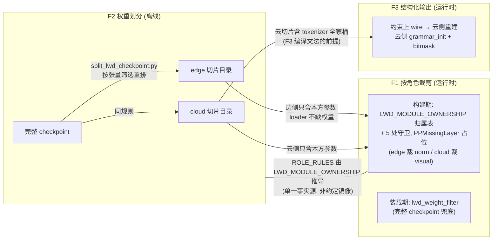

# LWD 边云三特性迁移总览 (F1/F2/F3)

> RFC issue: #TBD (本迁移总量 > 500 LOC, 按团队规范需关联 RFC)
>
> 文档系列:
>
> - [lwd_role_module_skip.md](lwd_role_module_skip.md) — F1 按角色裁剪模块
> - [lwd_weight_split.md](lwd_weight_split.md) — F2 权重划分 (离线切分)
> - [lwd_structured_output_migration.md](lwd_structured_output_migration.md) — F3 结构化输出

## 1. 背景与目标

将老代码基线 `prefill_only_chunked_prefill_mm` 谱系 (参照仓 `vllm_v23.0_prefill_only`, 分支 `test_01`) 中的三个特性迁移到本仓 `main`:

| 特性 | 内容 | 老代码载体 |
| --- | --- | --- |
| F1 | 按角色裁剪模块: 边侧不建 `model.norm`, 云侧不建 `visual` 塔 | `vllm/config/lwd.py` 的 `skips_module` + 模型守卫 + `lwd_weight_filter.py` |
| F2 | 权重划分: 离线把完整 checkpoint 按张量切分为 edge/cloud 两个切片目录 | `scripts/lwd/split_lwd_checkpoint.py` |
| F3 | 结构化输出: 约束随请求上 wire, 云侧编译文法并在采样点施加 bitmask | `lwd_notify.py` / 边调度器 / 云引擎 5 处改动 |

三特性服务于同一目标: **prefill_only 边云形态下, 边侧退化为 "embed + unembed + 视觉塔" 的薄壳, 云侧承载全部 transformer 层 + 采样**, 并让两侧各自只加载本方权重.

## 2. 目标仓库现状盘点

本仓 main 已完成 LWD 控制面/数据面整改, 与三特性相关的现状:

**已具备 (零改动)**:

- `vllm/model_executor/models/utils.py::make_layers` 已有 LWD 分支: `lwd_config.role == "edge"` 时 `start_layer = end_layer = 0`, 边侧全部层为 `PPMissingLayer` — 等价老代码 `(0,0)` 切分 (embed + lm_head only).
- pp=1 集中式运行, 建组由 `vllm/distributed/lwd/` 从拓扑推导 (`lwd_check_parallel_config`).
- 控制面 `vllm/v1/lwd_control/lwd_comm/` (ROUTER/DEALER), 请求逐字段过 wire (`LWD_SAMPLING_FIELDS`).
- rank-replay 数据面全链路 (`LwdC2eMeta`, `top_id_ths`, 回放), 批型 `LwdBatchType/LwdEmbedBatch/LwdUnembedBatch`.
- 原生结构化输出机制完备: `StructuredOutputManager` (含 `grammar_init`), `SamplingParams.structured_outputs`, bitmask 生成与施加.

**缺失 (本迁移要补)**:

- 无 `lwd_skips_module` / 模型构建守卫 — 边侧当前会构建 `norm` (pp=1 下 `is_last_rank=True`), 云侧会构建 `visual` 塔.
- 无 `lwd_weight_filter.py`, `_get_weights_iterator` 无 `skip_name` 谓词管道.
- 无切分脚本, `scripts/` 下无任何 lwd 工具.
- 边侧准入对结构化请求是**显式拒绝块** (`_lwd_validate_request`).

## 3. 架构约束 (AGENTS.md)

- **严禁带回两段 PP 写法**: 老分支借 `[边0, 云0]` 两段 PP 组 (pp=2 + 首/尾 rank 改写 + `not enable_lwd` 守卫) 表达边云, 本仓已去除. 迁移时 `pp=2`、首/中/尾 rank 概念、`mode` 字段、`make_lwd_layers` 非连续层段**一律不迁**.
- `head_tail` / `embedding_only` 协同模式已不再支持, 只保留 prefill_only 形态.
- 命名: `Lwd` 前缀、复用配置框架词汇、一个概念一个词; 迁移同一 commit 内 grep 清理旧术语 (`wire_version` / `enable_lwd` / `embedding_only`).
- 迁移/替换要一次做到位: 不留转发层与过时注释.

## 4. 三特性关系



核心耦合: **F2 的张量归属规则与 F1 的模块裁剪规则共用 `LWD_MODULE_OWNERSHIP` 这一张表** (方案 A, 单一事实源); F3 依赖 F2 的 METADATA_RULES 把 tokenizer 文件放进云侧切片.

## 5. 决策点 (已定案 2026-11-04, 依据见 F1 文档)

| # | 决策 | **定案** |
| --- | --- | --- |
| D1 | F1 规则的配置宿主: 老代码 `LwdConfig` 是行为配置 (enabled/mode/层切分), 本仓 `vllm/config/lwd/entry.py::LwdConfig` 是纯拓扑身份 | **方案 A**: 声明式归属表 `LWD_MODULE_OWNERSHIP` + 纯函数 `lwd_skips_module(module_path, role)` 落 `models/utils.py` (紧邻 make_layers); role 读已存在的 `lwd_config.role`, **LwdConfig 零改动**. 备选方案对比见 F1 §7 |
| D2 | norm 归属: 老设计边侧不建 norm (云侧 norm 后 hidden 下行); 本仓 pp=1 边侧 `is_last_rank=True`, 当前会建 norm | **边裁 norm**, 已核验回放路径: 云 forward 末 norm (deepseek_v2.py:1585) → 下行 hidden 已 post-norm; 边 `execute_lwd_unembed` 直调 `compute_logits` (无 norm). 证据链与 dspark 反例警示见 F1 §3.5 |
| D3 | 云侧关多模态的表达: 老代码用 `mm_encoder_remote`, 本仓只有 `mm_encoder_only` (语义相反) | **不迁**: 模型侧靠 F1 的 visual 裁剪表达 (`visual → edge`), processor 侧用既有 `role != "edge"` 网关 (F1 §5) |
| D4 | F1 装载过滤文件位置 | **镜像同目录先例** `model_executor/model_loader/ep_weight_filter.py`: 新建 `lwd_weight_filter.py`, skip 键从归属表推导 (F1 §4) |

## 6. 实施顺序

```text
PR1  F1 构建期裁剪     LWD_MODULE_OWNERSHIP + lwd_skips_module + lwd_role + 5 处模型守卫 + 单测
PR2  F1 装载期兜底     lwd_weight_filter.py + _get_weights_iterator skip_name 管道 + 单测
PR3  F2 切分脚本       scripts/lwd/split_lwd_checkpoint.py (规则与 PR1/PR2 镜像锁定)
PR4  F3 结构化输出     LWD_MESSAGE_VERSION bump + 5 接缝 + picker 过滤
```

依赖关系: PR2 依赖 PR1 (过滤键来自裁剪规则); PR3 与 PR1/PR2 同评审周期锁定镜像; PR4 依赖 PR3 (云侧切片须含 tokenizer).

每个 PR: `feat(lwd): ...` commit、`[Feature][Lwd]` 标签、与 vllm-ascend 关联 PR 互贴链接.

## 7. 验证总表

| 层 | 验证项 |
| --- | --- |
| F1 单测 | `skips_module` 点路径后缀匹配 (含 `visual.merger.norm` 反例); 完整 checkpoint + 过滤器 == 切片 checkpoint 加载结果 |
| F1 集成 | 两侧各自从本方切片启动成功; 误用对方切片应在加载期失败 (占位模块无参数) |
| F2 单测 | 规则覆盖报告 (每个张量有归宿); 两次切分逐字节一致; 源目录只读 guard |
| F3 单测 | wire 序列化/反序列化 roundtrip; 私有字段 (`_backend`) 处理 |
| F3 集成 | json_schema 约束请求端到端 (回放 token 合法性); 版本不匹配握手拒绝; picker 与云 native 调度选中集一致性 (加临时日志观察) |

两处**正确性关键点** (老代码踩过的坑, 详见 F3 文档 §5): 云侧显式 `grammar_init` (漏掉则请求永久滞留 `WAITING_FOR_STRUCTURED_OUTPUT_GRAMMAR`), 边 picker 的 grammar-ready 过滤 (漏掉则边云执行集不一致).
