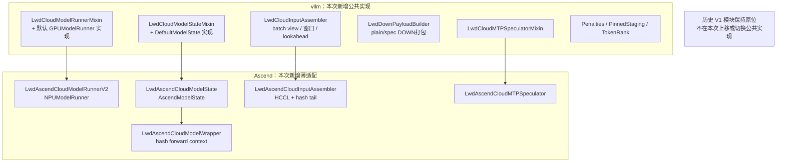
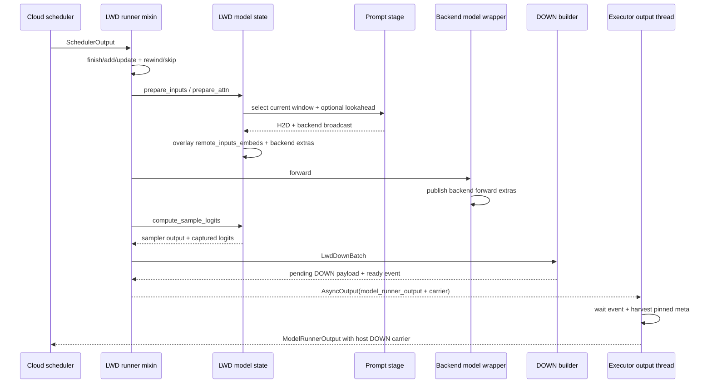

# LWD 边云场景适配 Model Runner V2 设计（新增代码上游化）

> 状态：实现候选。已完成新增代码与部分 CPU 验证；NPU ST 与 RFC 评审尚未完成，不能据此宣称 LWD 已支持 MRV2。
>
> 本版收敛范围：**只要求本次新增的 MRV2 代码尽量落在 vllm 上游，避免以后二次上移；
> 历史 V1 模块不在本次搬迁、改写或删除。** 后续历史上移单独立项。
>
> 基线：`vllm` @ `43f4d13f82a2de43a6bbc601bc63fe1e6e53333f`，
> `vllm-ascend` @ `ccc96f80f17e6cdb3555237be5edfe8372dbf53a`。
> 历史参考：`D:\work\AI_infer\main\origin_main\lwd_mrv2_adaptation_design.md`。

## 1. 背景与目标

LWD 当前仅支持 V1：`LwdCloudWorker.init_device()` 在检测到 V2 后直接报错，并且
`enable_prompt_embeds` 在父类 runner 构造完成后才设置。目标是让同一发布物中的
LWD 实例能够在构造期选择 V1 或 V2，V2 下保持现有边云语义、线协议和 DOWN
rank-replay 行为，并覆盖普通 decode、混合 prefill/decode、MTP 和 ACL graph。

本期必须保持：

- `prefill_only` 的边云分工不变：边端生成 prompt embeddings，云端完成 decoder、
  采样和 rank 编码，边端复现采样结果。
- UP/DOWN 数据面帧格式、seqno、载荷布局和业务消息版本不变。
- arrival/W1/W2、host staging、prefix READY/refill、preemption rewind/skip、abort
  tombstone 的语义不变。
- V1 的 runner、输入装配、token rank、pinned staging 和 DOWN 路径保持原位；除 V2
  接入所必需的 worker 选择逻辑外，不做历史上移或委托改造。
- V1 可继续运行，V2 失败不得静默降级为 V1 或与对端混用版本。
- eager、PIECEWISE、FULL graph 使用同一套正确性语义；不得用“能启动”代替图模式
  正确性。
- **本次新增的** runner、ModelState、prompt 注入、MTP、DOWN 打包和 penalties 尽量
  直接落在 vllm 上游，使其他 MRV2 后端可以复用，避免后续再次上移。

本期明确不做：

- 历史 V1 模块上移、删除、改名或切换到新公共组件。新增 V2 实现与历史 V1 实现可以
  暂时并存，后续历史上移时再统一收敛。
- DBO/ubatch。昇腾平台仍在 `platform.py` 中重置 `enable_dbo=False`、
  `ubatch_size=0`，LWD 不增加相关分支。
- `ngram`、`draft_model` 以及其他非 MTP 投机路径。现有 Ascend 黑名单继续生效；
  LWD 自己的 V2 启动校验也必须拒绝未适配方法，不能依赖用户不强开环境变量。
- batch-sharded sampling 和非默认 ModelState 的 hybrid/encoder 状态。遇到这些配置
  必须 fail-fast，后续按真实需求单独适配。
- **PCP/DCP 本期暂缓，不是宣称 LWD 不支持 PCP/DCP。** 未验证组合先拒绝启动，后续
  按实际需要设计 PCP 的 local/global embedding 布局和 DCP 的序列分片语义。
- structured output 的边云迁移（F3）。当前分支尚未恢复该能力，详见 §2.3；本期不将
  其误写为“已支持”，也不把 F3 与 MRV2 适配捆绑交付。

## 2. 当前代码事实与旧方案重审

### 2.1 当前真正的阻塞点

1. `lwd_cloud_worker.py` 在 V2 下抛出 `RuntimeError`，随后硬编码构造 V1
   `LwdCloudModelRunner`。
2. `enable_prompt_embeds=True` 设置过晚。V2 在 runner 构造时计算
   `uses_inputs_embeds`，并在 `DefaultModelState` 构造时创建 prompt-embed 状态。
3. V2 的 `RequestState`、`InputBatch`、采样输出和异步输出包装均与 V1 不同，不能
   只替换 runner 基类。
4. 云端请求没有真实 prompt token ids。`Request._all_token_ids` 会为其制造等长零
   占位，V2 又将这些值写入 `all_token_ids`。它们既会影响 embedding gather，也会
   影响 penalties 和 MTP。
5. V2 `sample()` 不返回 logits，而 DOWN rank 编码必须取得同一次采样所用的
   hidden/logits。
6. V2 `AsyncOutput` 的内部字段名为 `model_runner_output`，V1 兼容路径使用
   `_model_runner_output`。现有 DOWN carrier 若挂错层级，会在 `get_output()` 后丢失。

### 2.2 旧方案不能直接沿用的结论

| 旧判断 | 当前复核结论 |
| --- | --- |
| 需要新增 `on_step_begin/on_step_sampled` | 不需要。`ModelState.postprocess_state()` 已存在，但 host staging 的 consume 应留在窗口 H2D 提交时；抢占再在 `update_requests()` 对齐。 |
| 需要给 `PromptEmbedsState` 增加 append/rewind | 不需要。`prepare_inputs_embeds()` 已能完成当前 batch 注入，继续使用现有窗口 staging 更直接，也避免全 prompt 常驻设备。 |
| 需要新增 `prepare_forward_context` | 不需要。后端自有 model wrapper 可在实际 forward context 内发布 hash 三件套，且兼容 FULL capture/replay。 |
| 需要修改上游 `sample()` 以暴露 hidden/logits | 不需要增加通用采样钩子。普通路径由 `ModelState.compute_sample_logits()` 捕获；lmhead TP 只需让 Ascend V2 的既有覆写同样委托该方法。 |
| `AsyncOutput` 挂载任意属性即可 | 不够。必须统一内部输出对象；给 V2 `AsyncOutput` 增加 `_model_runner_output` 只读兼容 property 即可复用 worker/executor 现有收割路径。 |
| V2 gather 天然解决所有残留问题 | 只解决 tensor 行残留，不能解决零占位 token 的语义。`vocab_size` 哨兵也不能照搬，V2 `prompt_bin_mask` bincount 会越界。 |
| MTP 只需适配新的 `BaseSpeculator` 签名 | 不够。V2 非最终 prefill chunk 还需要下一行 prompt embedding；零值的 `next_prefill_tokens` 会造成静默错误，必须补 lookahead。 |
| `draft_model` 上游完全没有 speculator | 当前 Ascend 已有 `AscendStandaloneARSpeculator`，但 Ascend 黑名单仍拒绝，且 LWD 未验证其 prompt/draft 输入，继续不纳入本期。 |
| 版本戳写入 `LwdConfig` | 不合适。`LwdConfig` 是用户配置；`runner_kind` 应放入由配置派生的 `LwdControlPlaneSpec`。 |
| 新 V2 与历史 V1 一并上移、共享改造 | 超出本期范围。只把新增 V2 公共实现直接放在上游；V1 历史资产保持原位，后续再独立收敛。 |

### 2.3 Structured output 当前是否已恢复

**当前分支尚未恢复 LWD structured output。** 代码证据形成完整闭环：

1. 边端 `control_edge_scheduler/lwd_edge_scheduler.py::_lwd_validate_request()` 仍对
   `request.use_structured_output` 直接抛出 `ValueError`。
2. `LwdRequestNotify` 只有采样字段，没有 JSON schema、regex、choice 等文法载荷，
   云端无法重建请求级 `StructuredOutputsRequest`。
3. 云侧 `control_cloud_scheduler` 没有 structured-output 专属处理，也没有为边云请求
   补齐 `grammar_init`。
4. `docs/design/lwd_migration_overview.md` 将 F3 排在后续 PR4，并指出边侧显式拒绝块
   尚待移除；其链接的 `lwd_structured_output_migration.md` 当前不存在。

V2 原生 `StructuredOutputsWorker`、grammar bitmask 和 `sample()` 施加逻辑已经存在，
所以问题不在 MRV2 sampler，而在 LWD 的“约束上 wire + 云侧文法初始化 + 边侧 picker
就绪过滤”尚未接通。F3 后续应作为独立上游特性迁移，并需要业务消息版本升级，不能
借本次 MRV2 适配宣称支持。

## 3. 备选方案与决策

### 方案 A：新增 V2 公共实现直接上游化，历史 V1 保持原位（推荐）

在 vllm 上游新增 LWD/MRV2 公共组件，保留现有“按窗口 H2D、TP broadcast、覆盖当前
batch embeddings”的数据面。新增的 runner、ModelState、输入装配、DOWN 打包、MTP 和
penalties 都放在 vllm；Ascend 只实现 hash、实际数据面、lmhead TP 和后端类接线。

优点：新增代码以后无需再次上移，其他后端可以复用；V1 改动最小，回归面清晰。
缺点：新旧实现会在一段时间内并存，需要通过 V1/V2 对拍防止语义分叉，而不是在本期
强行合并历史代码。

### 方案 B：先迁移历史公共模块，再实现 V2

优点：最终只有一套公共代码。
缺点：把历史重构和 MRV2 新功能耦合，扩大回归面与评审成本，也拖慢 V2 接入，排除。

### 方案 C：完整 V2 实现主要放在 vllm-ascend

优点：初期修改集中，能快速覆盖 NPU。
缺点：其他后端无法复用，后续仍需把新增 V2 代码再上移一次，与本次目标冲突，排除。

**决策：采用方案 A。** 不新增 MRV2 ModelState 通用钩子，而是复用已有的类选择、
输入准备、采样和 speculator 接缝。上游只增加 LWD 自有模块与少量通用兼容改动。

## 4. 新增代码的上游/后端职责划分

### 新增上游公共部分

放在 `vllm/v1/worker/gpu/lwd/`：

- `model_runner.py`：`LwdCloudModelRunnerMixin` 和默认
  `LwdCloudModelRunnerV2(LwdCloudModelRunnerMixin, GPUModelRunner)`。
- `model_state.py`：`LwdCloudModelStateMixin` 和默认
  `LwdCloudModelState(LwdCloudModelStateMixin, DefaultModelState)`。
- `cloud_input.py`：`LwdCloudBatchView`、`LwdPromptStage` 协议和
  `LwdCloudInputAssembler`。
- `down_payload.py`：`LwdDownBatch`、`LwdDownPayloadBuilder`。
- `mtp_speculator.py`：`LwdCloudMTPSpeculatorMixin` 和默认 MTP 实现。
- `penalties.py`：`LwdCloudPenaltiesState`。
- `pinned_staging.py`、`token_rank.py`：**供新增 V2 使用的上游纯 torch 实现**；
  不删除、不迁移 Ascend 的既有实现，也不要求 V1 改用它们。

公共代码不得 import `torch_npu`、Ascend forward context、HCCL wrapper 或 Ascend
`LwdHostStager` 的具体类。事件/stream 使用与上游 MRV2 相同的 `torch.cuda` 兼容接口；
`LwdPromptStage` 只声明 `consumed_rows`、`recv_rows`、`segment_for`、`consume`、
rewind/skip 等结构协议，现有 Ascend stager 以结构化方式满足，无需继承或搬迁。

### 新增 Ascend 薄适配

放在 `vllm_ascend/worker/lwd_cloud_model/v2/`：

- `LwdAscendCloudModelRunnerV2(LwdCloudModelRunnerMixin, NPUModelRunner)`；
- `LwdAscendCloudModelState(LwdCloudModelStateMixin, AscendModelState)`；
- `LwdAscendCloudInputAssembler`，处理 HCCL broadcast 和 hash expert tail；
- `LwdAscendCloudModelWrapper`，通过 `_EXTRA_CTX` 发布 hash 三件套；
- `LwdAscendCloudMTPSpeculator`，复用 `AscendMTPSpeculator` 的图与模型加载。

历史 `lwd_pinned_staging.py`、`lwd_token_rank.py` 和 V1 runner 保持原位。新增 V2
代码直接使用上游新模块，后续历史上移时再判断是否去重，不在本次制造额外迁移。

## 5. 构造期版本决议与启动校验

### 5.1 版本来源

继续使用现有 `VLLM_USE_V2_MODEL_RUNNER` 和 `mrv2_utils.use_v2_model_runner()`，不新增
LWD 环境变量或用户配置项。engine 和 worker 都在初始化时把布尔结果转换为
`runner_kind ∈ {"v1", "v2"}` 并保存，之后不再切换。

`runner_kind` 是运行时派生值，放在 `LwdControlPlaneSpec`，不写入 frozen
`LwdConfig`。

### 5.2 三层一致性校验

1. **worker 实际 runner**：V1/V2 runner 分别声明类级 `runner_kind`。
   `LwdWorkerBase.lwd_model_runner_kind()` 返回实际 runner 的标记。
2. **engine 决议**：`LwdBaseEngineCore` 在启动控制面前通过 executor
   `collective_rpc("lwd_model_runner_kind")` 获取全部 rank 的标记，要求唯一且等于
   engine 的 `use_v2_model_runner` 决议。
3. **边云握手**：`LwdLinkHello`、`LwdLinkAccept` 追加带默认值的 `runner_kind`。
   cloud 拒绝与本地不同的 hello；edge 拒绝与本地不同的 accept。缺省按 `v1`
   解读，旧版本 V1 可继续互通；任何实际 V2 的不一致都 fail-closed。

握手只增加兼容字段，`LWD_LINK_PROTOCOL_VERSION` 和业务 `LWD_MESSAGE_VERSION` 不变；
UP/DOWN 数据面格式不变。

### 5.3 启动能力校验

V2 在模型加载前拒绝：

- 启用 `speculative_config` 但 `method` 不是 `mtp`（无投机配置允许）；
- batch-sharded sampling；
- hybrid/encoder-only 等当前未覆盖的 ModelState；
- PCP/DCP>1 等本期未验证组合，报错文案为“本期未覆盖”，不是永久不支持；
- DBO 和其他未验证组合。

`ngram/draft_model` 仍由 Ascend 黑名单默认落 V1；若用户显式强开 V2，LWD 也必须
给出明确错误，不能以零 prompt token 历史继续运行。现有 V4 Hash 的
`DP=PCP=DCP=1` 限制保持不变；其他 DP 场景不因此被一刀切。

## 6. 类选择与 Worker 改造

### 6.1 直接选择 LWD state，避免二次构造

上游 `resolve_model_state_cls()` 在云侧 LWD 且模型使用默认 state 时，直接返回
`LwdCloudModelState`；Ascend 的 `_resolve_ascend_model_state_cls()` 对应返回
`LwdAscendCloudModelState`。模型自定义 state 若不在当前支持白名单中，启动时明确
拒绝。

这样 `GPUModelRunner.load_model()` 只构造一次 state，不需要先建默认 state 再替换。
`prompt_logprobs_worker` 和 speculator 后续都绑定到同一对象。

### 6.2 Worker 初始化顺序

`LwdCloudWorker.init_device()`：

1. 在 `super().init_device()` 之前设置 `model_config.enable_prompt_embeds=True`。
2. 父类完成分布式环境和默认 runner 初始化。
3. 按已缓存的 `runner_kind` 构造唯一的 LWD runner：
   - V1：现有 `LwdCloudModelRunner`；
   - V2：`LwdAscendCloudModelRunnerV2`，传入 `worker=self`。
4. 初始化 LWD 数据面、early recv 和 host stager。
5. 仅 V1 注册旧的 `AscendSpecDecodeBaseProposer` prompt provider；V2 speculator 直接
   持有 LWD model state，不再使用进程级 provider。

`sample_tokens()` 改为调用 `super().sample_tokens()`，保留 Ascend worker 的 profiling
后处理，再取 runner 的 pending DOWN payload。`lwd_release_finished()` 与
`take_lwd_pending_down_payload()` 在两个 runner 上保持同一契约，worker 不需要
`isinstance` 分支。

除上述 V2 接入点外，不改变 V1 的构造和执行路径。

## 7. 公共 prompt embedding 注入

### 7.1 `LwdCloudModelStateMixin`

该 mixin 只使用 MRV2 公共接口：

- 将 `prompt_embeds_state` 置为 `None`，禁止上游把 meta prompt tensor 当作真实
  embedding 做 H2D。
- 分配固定地址的 `remote_inputs_embeds` 和 MTP next-prompt buffer。
- `dummy_inputs_embeds()` 与真实 `prepare_inputs_embeds()` 共用同一个
  `remote_inputs_embeds`，保证 capture/replay 地址稳定。
- `add_request()` 调用父类完成 rope/sampler 所需登记，但不再复制 meta embeddings；
  若带 `lwd_mrope_positions`，使用 V2 `RopeState.update_prefill_positions()` 写入
  权威 `[3, prompt_len]` 数据和 delta。
- `remove_request()` 清理 next-prompt 和后端扩展状态；host buffer 仍由 worker 的
  finished 路径释放，避免重复释放。
- `compute_sample_logits()` 记录本次 logits 后调用父类实现，不改变采样数值路径。

### 7.2 标准化 batch view 与对账

`LwdCloudInputAssembler` 不依赖 V1/V2 的 batch 类型。V2 从当步 `InputBatch` 转为
`LwdCloudBatchView`：

- `req_ids`、`idx_mapping_np`；
- `num_scheduled_tokens`；
- `num_computed_tokens_np`；
- `prefill_len_np`；
- `query_start_loc_np`。

V2 的 `req_states.num_computed_tokens_np` 与 scheduler 一样是本步乐观上界，host
`consumed` 仍在 H2D 提交时推进，因此沿用 V1 的对账时点，不引入 post-sample 新账本。

`LwdCloudModelRunnerMixin.update_requests()` 在父类更新后，对 cached requests 比较
`consumed` 与新的 computed：

- `consumed > computed`：rewind；
- `consumed < computed < W1`：skip；
- 超过 W1 或窗口 start 不一致：立即报错。

### 7.3 当前 batch embedding 覆盖

真实步骤中，`prepare_inputs_embeds()`：

1. 将 prompt 区输入 ids 安全地视为占位值，decode 区保留真实 sampled/draft ids；
2. 计算本地 embedding 并写入固定 `remote_inputs_embeds`；
3. 通过 input assembler 选出已到达且未消费的 prompt 窗口；
4. endpoint 从 prompt stage 发起窗口 H2D，其他 TP rank 参与后端 broadcast；
5. 用远端窗口覆盖当前 batch 的 prompt 行，并调用后端扩展处理可选的窗口附加数据；
6. 返回 `[0:num_tokens_after_padding]` 的固定 buffer。

公共 assembler 只处理 embeddings 和 MTP lookahead。Ascend 子类通过受保护扩展点处理
hash expert tail，公共层不认识 hash 类型。

缺失窗口、越过 W1、几何不一致或广播失败都直接失败，不允许用旧 buffer 或占位值
继续 forward。dummy run 不读取 prompt stage，并将真实批次扩展标记清空。

此路径不执行云端视觉 encoder，因为视觉模块按角色在边端执行，远端 embeddings 已
包含多模态结果。

## 8. Ascend Hash MoE 与 FULL graph

### 8.1 固定缓冲与模型输入

`LwdAscendCloudModelState` 额外持有：

- `_lwd_hash_experts`；
- `_lwd_hash_prompt_mask`；
- `_lwd_hash_token_ids`；
- `_lwd_hash_placeholder_ids`。

真实批次按 `LwdCloudBatchView` 重建本步 hash 数据，保留已有
`LwdHashRoutingState.build_batch()` 和 `DP=PCP=DCP=1` 限制。`prepare_inputs()` 在 hash
模型下把固定 placeholder ids 写回 `model_inputs["input_ids"]`，覆盖上游在
inputs-embeds 分支设置的 `None`。placeholder 只用于满足模型层签名，router 会在读取
前替换为行索引。

### 8.2 forward-context 注入

`LwdAscendCloudModelWrapper` 包装已加载模型，其 `forward()` 中：

1. 读取已存在的 `_EXTRA_CTX`；
2. 写入 `input_ids`、`lwd_hash_expert_ids`、`lwd_hash_prompt_mask`；
3. dummy/capture 时使用全零 mask 和合法 token 0；
4. 调用原始模型。

`prepare_dummy_inputs()` 同样提供 placeholder ids 和 dummy embeddings。由于所有缓冲
在 state 初始化时分配，FULL capture 记录的地址与 replay 相同；真实步骤只更新
内容，不重新分配。

speculator 在 wrapper 安装前已使用原始模型完成加载；wrapper 的 `__getattr__` 只负责
委托模型方法，不参与 draft 权重构造。通用上游层不包含这些 Ascend 私有逻辑。

## 9. DOWN 采样与异步输出

### 9.1 捕获同一次采样的 hidden/logits

公共 `LwdCloudModelStateMixin.compute_sample_logits()` 记录本次 logits。
`LwdCloudModelRunnerMixin.sample()` 在调用父类前：

- 保存当步 `input_batch` 的请求顺序、`idx_mapping_np` 和
  `num_draft_tokens_per_req`；
- 通过 `hidden_states[input_batch.logits_indices]` 取得 `sample_hidden_states`；
- 清除上一次捕获，避免异常时误用旧 logits。

父类采样后，使用本次 `sample_hidden_states`、捕获的 logits 和
`SamplerOutput.sampled_token_ids` 构造 `LwdDownBatch`。

Ascend lmhead TP 分支改造前直接调用 `self.model.compute_logits()`，现改为调用
`self.model_state.compute_sample_logits()` 后再裁剪 padded rows，并登记该裁剪后的
同一 tensor 供 LWD DOWN 使用。默认实现仍委托 `model.compute_logits()`，行为不变；
非 batch-sharded 的其它采样逻辑保持不变。

### 9.2 标准化 DOWN 输入与打包

`LwdDownBatch` 包含：

- `sample_hidden_states`、`logits`、`sampled_token_ids`；
- `req_ids`、`valid_rows`；
- 可选 `num_draft_tokens_per_req`。

V2 直接使用 `input_batch.num_draft_tokens_per_req`，不伪造 V1 的
`spec_decode_metadata` 或 discard mask，`valid_rows` 来自当步有效请求映射。

新增的上游 `LwdDownPayloadBuilder` 按现有协议实现纯 torch 逻辑：

- 无 draft：每请求一行，plain counts/seg lengths 布局不变；
- 有 draft：`1 + num_draft_tokens_per_req` 为段长，按实际 hidden rows 截断，
  rejected slots 的 rank 置零；
- hidden packet、rank、counts、seg lens、ready event 和 req_ids 的格式与 V1 相同；
- scheduler 仍以 `EngineCoreOutputs.new_token_ids` 的真实提交数覆盖
  `num_accepted_tokens`，不把设备上界当作最终提交数。

共享 builder 的函数输入收敛到 `LwdDownBatch`，避免多个长参数列表。V1 不切换到该
builder；它只作为新增 V2 的上游实现，与现有 V1 做行为对拍。

### 9.3 AsyncOutput 兼容

在 V2 `AsyncOutput` 上增加只读 `_model_runner_output` property，返回现有
`model_runner_output`。这样：

- worker 的 `getattr(output, "_model_runner_output", output)` 取得真正的
  `ModelRunnerOutput`；
- executor output thread 取得同一个对象，等待 ready event 并把 device meta 收割为
  pinned host carrier；
- `get_output()` 后 scheduler 仍能看到 `lwd_down_carrier`。

不需要第二套 carrier，也不需要把 device meta 直接交给 scheduler。

## 10. MTP 适配

### 10.1 公共流程复用，后端只负责具体 speculator

在 `TargetDependentARSpeculator._run_model()` 中提取现有的 draft model-input 准备为
一个受保护 helper，`LwdCloudMTPSpeculatorMixin` 只覆盖该 helper，避免复制 forward
context、graph replay 和采样流程。dummy run 使用原生路径。

上游 speculator 工厂在云侧 LWD + `method="mtp"` 时选择公共实现；Ascend 工厂选择
`LwdAscendCloudMTPSpeculator`，继续复用 `AscendMTPSpeculator` 的模型加载、
`init_cudagraph_manager()`、capture 和多步 draft 图。

### 10.2 真实 prompt 的 draft 输入

对包含 prompt 行的 draft 首步：

- 用安全占位 ids 生成本地 embedding 作为 seed；
- 按 target query window 右移一位，将 target 的
  `remote_inputs_embeds[s+1:e]` 覆盖到 draft `[s:e-1]`；
- decode/sampled 的最后一行继续使用真实 sampled token 的 embedding；
- 非最终 prefill chunk 的最后一行不能使用 `next_prefill_tokens` 的零占位，必须使用
  下一行远端 prompt embedding；
- 没有 prompt 行时保留原生 token-id 路径，避免给纯 decode 增加拷贝。

`supports_mm_inputs` 在 LWD speculator 中关闭，防止原生路径再次 gather 云端不存在的
视觉 encoder cache；这里的 inputs-embeds 来自边端权威数据，与是否多模态无关。

### 10.3 Lookahead staging 与 W2

公共 input assembler 为 MTP 增加固定 `next_prompt_embeds[req_state_idx, H]`：

- 当前窗口为 `[start, start+rows)` 且请求仍有后续 prompt 时，从 prompt stage 读取
  `start+rows` 行；
- 该行随后端窗口数据一起广播，不增加消费计数，也不改变外部 UP 协议；
- `next_prompt_embeds` 只用于 draft 的最后一行，不影响 target 的当前窗口；
- request 完成/重准入时按 req-state 覆盖或清理，禁止读到上一任请求的数据。

云 scheduler 使用 `vllm_config.num_prefill_lookahead_tokens` 补齐 W2：非最终 prefill
窗口除满足 `start+rows <= W1` 外，还必须满足
`start+rows+num_prefill_lookahead_tokens <= W1`。未到达时本步不调度该窗口；如果
协议或几何已不一致，则 fail-fast，而不是退回 token-id fallback。

## 11. Placeholder token ids 与 penalties

零占位 ids 可以继续用于满足 V2 的 `prefill_token_ids` 长度和 RoPE 扫描，但不能直接
作为真实 prompt 历史参与采样。

不能使用 `vocab_size` 哨兵：V2 的 `prompt_bin_mask` 会以 token id 生成位图索引，越界
写入会引入新的设备错误。

本期沿用 V1 的“未知 prompt token 不参与 penalty，真实生成 token 正常计数”口径：

- 上游 `LwdCloudPenaltiesState.apply_staged_writes()` 先复用父类完成真实 output
  token bincount，再清空 prompt mask；
- runner 在加载后将该 state 接入 sampler、`logits_processors` 中的对应项，以及
  `postprocess_sampled()` 共用的 `penalties_state`；
- token 0 不再因整段零占位而获得错误的 presence/repetition 影响；
- sampled/draft 的真实 output token 仍由原 `post_update()` 正常累计。

这不扩展边云协议，也不宣称集中式 prompt-penalty 语义已得到新增支持；它只是避免
V2 相对 V1 出现新的零占位偏差。

## 12. 端到端时序

## 13. 变更落点

### vllm 上游（本次新增的主要实现）

| 文件 | 设计动作 |
| --- | --- |
| `v1/worker/gpu/lwd/model_runner.py` | 新增公共 runner mixin 和默认 `LwdCloudModelRunnerV2`。 |
| `v1/worker/gpu/lwd/model_state.py` | 新增公共 state mixin 和默认 `LwdCloudModelState`。 |
| `v1/worker/gpu/lwd/cloud_input.py` | 新增 batch view、prompt-stage 协议、窗口/lookahead assembler。 |
| `v1/worker/gpu/lwd/down_payload.py` | 新增供 V2 使用的 `LwdDownBatch` 和 DOWN builder。 |
| `v1/worker/gpu/lwd/mtp_speculator.py` | 新增公共 MTP mixin 和默认实现。 |
| `v1/worker/gpu/lwd/penalties.py` | 新增 `LwdCloudPenaltiesState`。 |
| `v1/worker/gpu/lwd/pinned_staging.py` | 新增供 V2 使用的上游纯 torch staging，不搬迁历史实现。 |
| `v1/worker/gpu/lwd/token_rank.py` | 新增供 V2 使用的上游 rank encoder，不搬迁历史实现。 |
| `v1/worker/gpu/model_states/__init__.py` | 默认 state 选择链接入 LWD。 |
| `v1/worker/gpu/async_utils.py` | 为 V2 AsyncOutput 增加 `_model_runner_output` 兼容 property。 |
| `v1/worker/gpu/spec_decode/target_dependent_ar/speculator.py` | 提取 draft model-input 准备 helper。 |
| `v1/lwd_control/lwd_comm/lwd_control_plane.py` | Spec 保存 runner_kind，hello/accept 构造与校验。 |
| `v1/lwd_control/lwd_comm/lwd_control_plane_factory.py` | 从 engine 决议生成 runner_kind。 |
| `v1/lwd_control/lwd_comm/lwd_link_protocol.py` | hello/accept 追加 runner_kind。 |
| `v1/lwd_control/lwd_comm/lwd_handshake.py` | 双向版本不一致拒绝。 |
| `v1/lwd_control/control_scheduler/lwd_base_engine.py` | RPC 核对 engine/worker 版本。 |
| `v1/lwd_control/control_cloud_scheduler/lwd_cloud_scheduler.py` | W2 增加 MTP lookahead 到达约束。 |

### vllm-ascend（本次新增的薄适配与必要接线）

| 文件 | 设计动作 |
| --- | --- |
| `worker/lwd_cloud_model/lwd_cloud_worker.py` | 前置 prompt-embed 开关、按 runner_kind 构造、统一 worker sample 后处理；其余 V1 路径不变。 |
| `worker/lwd_base_model/lwd_worker_base.py` | 增加实际 runner_kind 查询 RPC。 |
| `worker/lwd_cloud_model/v2/model_runner.py` | 新增 `LwdAscendCloudModelRunnerV2`。 |
| `worker/lwd_cloud_model/v2/model_state.py` | 新增 `LwdAscendCloudModelState` 和 state 选择接线。 |
| `worker/lwd_cloud_model/v2/cloud_input.py` | 新增 HCCL/hash 输入装配子类。 |
| `worker/lwd_cloud_model/v2/model_wrapper.py` | 新增 `LwdAscendCloudModelWrapper`。 |
| `worker/lwd_cloud_model/v2/mtp_speculator.py` | 新增 `LwdAscendCloudMTPSpeculator`。 |
| `worker/v2/model_runner.py` | lmhead TP 的 logits 计算委托给 model state。 |
| `worker/v2/model_states/__init__.py` | 接入 Ascend LWD state 选择。 |
| `worker/v2/spec_decode/__init__.py` | LWD MTP 选择 Ascend 子类。 |

明确不修改或删除：

- `worker/lwd_cloud_model/lwd_cloud_model_runner.py` 的 V1 执行逻辑；
- `worker/lwd_base_model/lwd_pinned_staging.py`；
- `worker/lwd_cloud_model/lwd_token_rank.py`；
- 其他仅为“统一新旧实现”而需要改写的历史模块。

实现完成后同步更新两仓 `AGENTS.md` 的模块地图和 MRV2 状态，但不修改
`TEAM STANDARDS` 标记区。该架构改造预计超过 500 LOC，实施前先创建 RFC issue，
两个仓的 PR 关联同一 RFC 并互相链接。

## 14. PCP/DCP 后续扩展边界

本期拒绝未验证组合只是交付闸口，不是架构排除。后续按真实需求评估：

- PCP：`InputBatch.pcp`、`pcp_manager.partition_batch()`、`global_batch` 与
  `restore_for_sampling()` 的 local/global embedding 和 DOWN 行序；
- DCP：`dcp_local_seq_lens`、序列分片后 prompt 窗口、hash 行和 DOWN rank 的对应关系；
- MTP：draft 是否使用 global tokens，以及 PCP 下 target/draft embedding 的不同布局；
- 图模式：local/global 固定 buffer 的形状与 replay 地址。

这些需求应复用上游 batch view 和后端扩展点，不在本期用 Ascend 特判预先写死。

## 15. 验证设计

### 15.1 UT 清单（提交前需人工审查）

1. runner_kind：V1/V2 相同版本握手成功，双向不匹配拒绝，engine/worker RPC 不一致
   拒绝。
2. AsyncOutput：V2 carrier 经 worker 挂载、executor 收割和 `get_output()` 后仍保留，
   ready event 只消费一次。
3. embedding 注入：单请求、混合 prefill/decode、chunk 边界、graph padding、missing
   arrival、rewind、skip、abort。
4. M-RoPE：权威 payload 覆盖、delta、错误长度拒绝。
5. hash/graph：连续两次不同 batch 的固定地址不变，dummy 后无真实 mask 残留，
   PIECEWISE/FULL replay 内容正确。
6. DOWN builder：plain/spec、有效请求过滤、实际 hidden 截断、 rejected rank=0；
   新 V2 builder 与当前 V1 行为对拍，但不要求 V1 改用新 builder。
7. lmhead TP：padded logits 裁剪与捕获 logits 是同一 tensor，不多算一次 lm_head。
8. MTP：右移窗口、纯 decode、最终/非最终 prefill、lookahead 缺失拒绝、req-state 行
   复用后无旧 embedding。
9. penalties：整段零占位不会制造 token 0 的 prompt presence，真实 output token 仍
   正常计数。
10. 启动拒绝：非 MTP spec、batch-sharded sampling、非支持 model state、本期暂缓的
    PCP/DCP 和其他非法组合。
11. 公共/后端隔离：上游新增 LWD 模块不 import `torch_npu`/Ascend 类型；默认
    `LwdCloudModelRunnerV2` 能使用 `DefaultModelState` 完成构造，Ascend 只覆写声明的
    扩展点。
12. V1 无回归：既有 LWD 单测保持通过，V1 runner、token rank、pinned staging 和 DOWN
    路径没有因 V2 接入被替换。

UT 优先扩展现有 `test_lwd_*`、worker/v2 和控制面测试；每个测试只覆盖一个行为，
真实构造对象，不以“未抛异常”作为唯一判据。

### 15.2 NPU ST 矩阵

- runner：V1 对照组、V2 实验组；
- 执行方式：eager、PIECEWISE、FULL；
- 投机：无 MTP、MTP；
- 请求：文本、图片、短/长 prompt、chunked prefill、混合 batch；
- 并发：1、8、32；
- prefix：关闭、READY 命中、refill、preemption 后重准入；
- 异常：abort、迟到 arrival、缺失窗口、重复/乱序 seqno；
- 拓扑：当前支持的 TP/EP、lmhead TP 开关；DSV4 hash 保持现有限制。

判据：

- 相同 runner、相同输入下，V1/V2 greedy 或 seeded 输出逐 token 一致；若后端数值
  路径导致合法差异，则按现有模型测试方式比较 logprobs，不能简单放宽容差。
- 共享协议下，新 V2 builder 与当前 V1 的单元对拍必须逐字节一致；端到端 hidden 只
  要求达到模型既有精度标准，不承诺不同 runner kernel 的 hidden 位级一致。
- DOWN seqno、hidden rows、ranks、accepted counts、finish reasons 与调度提交一致。
- request 完成后 host bytes 和 hash/next-prompt 状态回落，无跨请求污染。
- 性能报告分别给出 forward、H2D/broadcast、sample+collect、meta-harvest 和端到端
  吞吐；不得新增热路径 `.item()`、pageable H2D 或每步全 prompt 拷贝。

所有 NPU 改动需在 Ascend 910B/C 真机验证后才可请求评审。

## 16. 实施阶段与出口

| 阶段 | 内容 | 出口 |
| --- | --- | --- |
| P0 | RFC、runner_kind/握手、AsyncOutput、V1 既有回归 | V1 行为不变；版本不一致和 carrier 丢失均有失败测试。 |
| P1 | 上游新增 runner/state/assembler、Ascend 薄接线、普通 DOWN | 无投机、无 hash 的 eager 文本/图片、混合 batch、prefix/abort 通过。 |
| P2 | Ascend hash wrapper、固定缓冲、PIECEWISE/FULL、lmhead TP | hash 模型图模式与 lmhead TP 矩阵通过。 |
| P3 | 上游新增 MTP、lookahead W2/staging、penalties | MTP 非最终 chunk、抢占、图模式和长稳通过；完成 AGENTS 更新。 |

P0 不做任何历史模块搬迁。P1 未通过前不进入图模式，P2 未通过前不进入 MTP，避免
多个变量同时失控。历史上移不在这些阶段的隐含工作中，必须另行评审。

## 17. 主要风险与控制

| 风险 | 控制 |
| --- | --- |
| 零占位被当作真实 prompt token | prompt overlay、penalty 清零、MTP 远端输入三处分别验证；禁止 vocab_size 哨兵。 |
| MTP 最后一行使用零 embedding | W2 lookahead + next-prompt 固定缓冲 + 非最终 chunk 专项 ST。 |
| FULL capture 读取旧地址或上一批数据 | 初始化分配全部图输入；dummy 清标记；地址与内容分别断言。 |
| AsyncOutput carrier 丢失 | 单一兼容 property，executor 收割后再断言 scheduler 可见。 |
| Ascend 类型泄入上游 | 上游只依赖 MRV2 和 prompt-stage 协议；增加 import 隔离检查。 |
| 新旧实现并存导致语义漂移 | 用 V1/V2 对拍约束新增实现；历史上移另行评审，不在本期强行去重。 |
| model wrapper 影响模型加载/speculator | 在权重与 draft 加载完成后安装；模型方法只委托，不改变原始模型对象在 state/speculator 中的引用。 |
| 未适配配置静默运行 | 启动白名单与 runner_kind 双向 fail-fast，不自动降级。 |
| 性能被全 prompt 拷贝或新增同步拖垮 | 只传当前窗口和 MTP 必需的一行；沿用事件与 pinned staging，性能分项必须给基线。 |

## 18. 设计结论

本方案以 MRV2 的公共接口承载**新增** LWD V2 代码，同时保持历史 V1 资产原位：

- 用 `prepare_inputs_embeds()` 完成窗口注入，不改上游 PromptEmbedsState；
- 用后端 model wrapper 完成 hash forward-context 注入，不新增通用 forward hook；
- 用 model-state logits 捕获和 AsyncOutput 兼容 property 保留下行 rank-replay；
- 用 lookahead staging 解决 V2 MTP 的真实缺口；
- 用控制面 Spec、executor RPC 和握手完成边云版本闭环；
- 将本次新增的 runner、state、MTP、DOWN 和 penalties 直接放在 vllm 上游，Ascend 仅
  保留明确的硬件差异，不在本次搬迁历史 V1 模块。

这样既避免新增代码未来再次上移，也把 V1 回归面限制在 V2 必需的接线上。后续其他
MRV2 后端可以复用同一套新增公共执行语义，历史上移则作为独立工作单独评审。

## 19. 实现与验证现状（2026-11-11）

### 已实现代码

- runner_kind 握手、engine/worker 一致性检查、AsyncOutput 内部输出兼容属性。
- 上游 V2 prompt 窗口、lookahead、ModelState、DOWN builder、MTP helper、penalties。
- Ascend runner/state 接线、Hash-MoE 固定缓冲、HCCL 广播、lmhead TP 捕获。
- V1 的历史 runner、token rank、pinned staging 未迁移，未改成委托新公共组件。
- PCP/DCP、structured output、DBO、ngram、draft_model、batch-sharded sampling 保持本期边界；PCP/DCP 是暂缓而非永久不支持。

### CPU 验证记录

- 新增上游 LWD 与 AsyncOutput 用例：17 项通过。
- 聚焦握手与 arrival 调度用例：43 项通过。
- 新增 Ascend 广播、Hash、wrapper、lmhead TP 用例：4 项通过。
- 既有 Ascend V2 model-runner 回归：192 项通过，1 项跳过。
- 全部 LWD 控制面用例：158 项通过，3 项失败。
- 全部 Ascend LWD 用例：176 项通过，18 项失败，4 项 setup error，另有 3 个 subtest 通过。

Windows 测试使用本地 `.venv`；`uvloop` 与 `fcntl` 只在测试进程提供兼容入口，CUDA event/stream 与 pinned memory 使用轻量 CPU 边界替代。这些检查覆盖业务逻辑，不覆盖真实 NPU 图捕获、HCCL 或设备内存行为。

### 未通过的既有回归

- `test_lwd_cloud_prefix_engine.py` 的 2 个 `cache_blocks` 调用断言。
- `test_worker_base_weave_guard.py` 的 1 个既有 `lwd_role_of` / `lwd_skips_module` 静态断言。
- Ascend LWD 旧用例中的 AST/行为断言，包括按旧结构查找 V1 方法的 setup error；这些未通过项不属于本次新增 V2 用例的通过范围。相关历史 V1 文件和旧测试没有因此被重写或删除。

### 尚未完成的出口条件

- 910B/C 上的 eager、PIECEWISE、FULL、MTP、混合 batch、prefix/refill/preemption/abort、TP/EP、lmhead TP 验证。
- V1/V2 输出与 DOWN 协议对拍、并发与长稳、性能基线。
- RFC issue 尚未创建；进入 PR 评审前必须创建并关联两仓 PR，完成 committer 评审。

在上述条件完成前，本实现只能作为候选代码，不能宣称 LWD 已支持 Model Runner V2。
