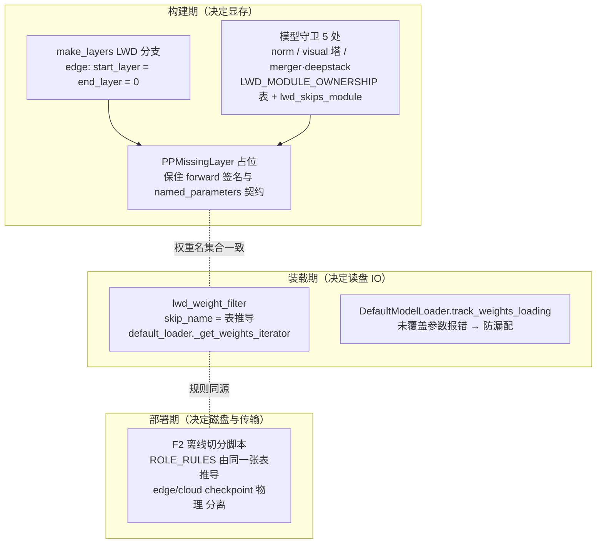

# LWD 按角色模块裁剪（F1）迁移设计：声明式归属表 + 纯函数（方案 A）

| | |
| --- | --- |
| 状态 | 待评审 |
| RFC | #TBD（预计 >500 LOC，按 AGENTS.md 需开 RFC 后回填） |
| 上游实现 | vllm_v23.0_prefill_only @ test_01（prefill_only_chunked_prefill_mm 谱系） |
| 总览 | [lwd_migration_overview.md](lwd_migration_overview.md) |
| 关联 | [lwd_weight_split.md](lwd_weight_split.md)（F2）、[lwd_structured_output_migration.md](lwd_structured_output_migration.md)（F3） |

## 0. 决策定案摘要

| 决策点 | 定案 | 详见 |
| --- | --- | --- |
| D1 裁剪逻辑宿主 | **方案 A：声明式归属表 `LWD_MODULE_OWNERSHIP` + 纯函数 `lwd_skips_module(module_path, role)`，LwdConfig 零改动** | §3.1–§3.3 |
| D2 norm 归属 | **边裁 norm（`model.norm` → cloud）**，回放路径已核验 | §3.5 |
| D3 云侧关多模态 | **模型侧 visual 裁剪表达 + processor 侧既有网关**，不迁 `mm_encoder_remote` | §5 |
| D4 装载期过滤器 | **镜像 `ep_weight_filter` 挂点**（`model_loader/lwd_weight_filter.py` + `default_loader` skip_name 管道） | §4 |

## 1. 目标与模块归属表

迁移"按边云角色裁剪模型模块"：**edge = embed + 视觉塔 + lm_head（0 个 transformer 层，unembed 回放）**，**cloud = 全部层 + norm + MTP + 采样 + 秩编码**（rank-replay 架构，谱系见总览）。裁剪分两层执行：构建期决定**显存占用**（不建即不占），装载期决定**读盘 IO**（读盘前丢弃）。

模块归属表（即 §3.1 的 `LWD_MODULE_OWNERSHIP`，本节为语义说明）：

| 模块（点路径后缀） | edge | cloud | 依据 |
| --- | --- | --- | --- |
| `model.embed_tokens` | 保留 | 保留 | 边侧 embed 计算；云侧量小保留，减少差异面（源仓既定） |
| `lm_head` | 保留 | 保留 | rank-replay 前提：云采样 + 边回放各用一次 |
| `model.layers` | 裁（0 层） | 保留 | `make_layers` LWD 分支（目标仓 main 已存在） |
| `model.norm` | 裁 | 保留 | D2 定案（§3.5 证据链） |
| `visual` | 保留 | 裁 | D3 定案（§5） |
| `model.mtp` | 裁 | 保留 | drafter 归云（MTP 在云侧 propose；目标仓 mtp 模型见 `deepseek_mtp.py` 等） |

注：`tid2eid` 是**张量级**特例，不入模块表，由 F2 ROLE_RULES 正则处理（见 F2 §4）。

## 2. 三层防漏

裁剪漏一层不会报错，只会显存浪费或权重双写，因此三层各司其职、互为校验：



## 3. 构建期：归属表 + 纯函数（方案 A / D1 定案）

### 3.1 `LWD_MODULE_OWNERSHIP` 与 `lwd_skips_module`

落点：`vllm/model_executor/models/utils.py`，紧邻 `make_layers` 既有 LWD 分支（零新文件；与源仓 `make_lwd_layers` 同址）。

```python
# vllm/model_executor/models/utils.py
LwdRole = Literal["edge", "cloud"]

#: 模块点路径后缀 → 归属角色集。三个消费方共用（单一事实源）：
#:   1. 构建期：make_layers 分支 + §3.4 模型守卫
#:   2. 装载期：model_loader/lwd_weight_filter.py（§4）
#:   3. 离线切分：scripts/lwd/split_lwd_checkpoint.py 的 ROLE_RULES（F2 §6）
_LWD_BOTH: frozenset[LwdRole] = frozenset(("edge", "cloud"))

LWD_MODULE_OWNERSHIP: dict[str, frozenset[LwdRole]] = {
    "model.embed_tokens": _LWD_BOTH,
    "lm_head": _LWD_BOTH,
    "model.layers": frozenset(("cloud",)),  # 构建期由 make_layers 执行；此行供装载期/F2 推导
    "model.norm": frozenset(("cloud",)),    # D2 定案（§3.5）
    "visual": frozenset(("edge",)),         # D3 定案（§5）
    "model.mtp": frozenset(("cloud",)),
}


def lwd_skips_module(module_path: str, role: str) -> bool:
    """``role`` 是否不得构建 ``module_path``（点路径）。

    点边界后缀匹配（源仓 skips_module 语义）：``path == suffix`` 或
    ``path.endswith("." + suffix)``。``visual.merger.norm`` 不以
    ``.model.norm`` 结尾，不会被 norm 规则误伤；``visual`` 后缀整树
    覆盖 ``visual.*``（merger/deepstack 随塔消亡）。禁止退化为裸属性名
    相等（``path == "norm"``）——那会把视觉塔内部的 merger.norm 一起裁掉。
    """
    for suffix, owners in LWD_MODULE_OWNERSHIP.items():
        if module_path == suffix or module_path.endswith("." + suffix):
            return role not in owners
    return False
```

签名取 `role: str` 而非 `LwdConfig` 对象：裁剪判定只依赖角色这一个标量，收窄耦合面，也让 F2 离线脚本与单测不必构造 config。

### 3.2 role 的来源：已存在的管道，LwdConfig 零改动

- 目标仓 `LwdConfig`（`vllm/config/lwd/entry.py`）是**纯拓扑身份** frozen dataclass（path/role/instance_id/topology/coordination/api），`from_dict` 对未知字段直接报错——本特性**不给它增加任何字段或方法**。
- role 的读取管道 main 上已存在：`make_layers` 的 LWD 分支（utils.py:880-885）已按 `vllm_config.lwd_config.role == "edge"` 置 0 层。模型守卫沿用同一模式，提供公开 helper：

```python
def lwd_role() -> str | None:
    """当前进程的 LWD 角色；非 LWD 部署返回 None（守卫零开销放行）。"""
    cfg = get_current_vllm_config_or_none()
    lwd = getattr(cfg, "lwd_config", None)
    return lwd.role if lwd is not None else None
```

- 非 LWD 部署：`lwd_config` 为 None → `lwd_role()` 返回 None → 所有守卫走原路径，零行为变化。

### 3.3 为什么裁剪逻辑不进 LwdConfig（方案 A 论证）

1. **纯拓扑收敛方向**：目标仓已把 `mode`/`edge_head_tail_layers` 等运行策略从 LwdConfig 剥离（AGENTS.md 亦废弃 `head_tail`/`embedding_only`）。模块归属是下一个候选剥离物而非新增物。
2. **Spec/Config 分工**（AGENTS.md 命名约定）：Config = 用户可写（YAML/CLI）；Spec = 由配置推出交给运行时。模块归属是**模型结构事实**，没有用户可写面——它应该是代码常量，不是配置节。
3. **F2 单一事实源**：离线切分脚本 `import LWD_MODULE_OWNERSHIP` 拿到同一对象；若表挂在 LwdConfig 上，脚本就得构造 config 或复制规则，镜像纪律退化为约定。
4. **源仓教训**：`skips_module` 挂在 LwdConfig 上，本次迁移中 `enabled`/`mode`/`edge_head_tail_layers` 全部作废，只有 `role` 有用——越靠近配置的策略越难跨仓迁移。

### 3.4 模型守卫（7 处）

守卫只建模块、不写 forward 分支（占位模块保住调用点签名）：

| 文件 | 站点 | 点路径 | 现状 |
| --- | --- | --- | --- |
| [deepseek_v2.py](../../../vllm/model_executor/models/deepseek_v2.py) :1481 | final norm | `model.norm` | 无守卫，需加 |
| [qwen3_5.py](../../../vllm/model_executor/models/qwen3_5.py) :269-272 | norm | `model.norm` | 已有 `is_last_rank` PP 分支，需在其上追加 LWD 条件 |
| [qwen3_5.py](../../../vllm/model_executor/models/qwen3_5.py) :513 | visual 塔 | `visual` | 无守卫，需加 |
| [qwen3_5.py](../../../vllm/model_executor/models/qwen3_5.py) :732 | merger/deepstack | 随 `visual` 整树 | 塔为 None 时不建 |
| [qwen3_vl.py](../../../vllm/model_executor/models/qwen3_vl.py) :1862 | visual 塔 | `visual` | 无守卫，需加 |
| [deepseek_v4/nvidia/model.py](../../../vllm/models/deepseek_v4/nvidia/model.py) :1417 | final norm | `model.norm` | V4 新 layout（非 model_executor 老布局）；已有 `is_last_rank` PP 分支，需在其上追加 LWD 条件 |
| `vllm_ascend/models/deepseek_v4/model.py` :848 | final norm | `model.norm` | vllm-ascend 仓 NPU 覆写实现（真机实际路径），同样追加 LWD 条件，随 vllm-ascend 侧 PR |

调用形式（以 visual 塔为例）：

```python
from vllm.model_executor.models.utils import lwd_role, lwd_skips_module

_role = lwd_role()
if _role is not None and lwd_skips_module("visual", _role):
    self.visual = PPMissingLayer()   # forward 调用点签名不变
else:
    self.visual = Qwen3_VisionTransformer(...)
```

qwen3_5:269 的 norm 站点在既有 PP 分支上追加：

```python
if get_pp_group().is_last_rank and not lwd_skips_module(
    "model.norm", role
):   # role 取自 lwd_role()；None 时 not skips 为 True，原语义不变
    self.norm = Qwen3_5RMSNorm(...)
else:
    self.norm = PPMissingLayer()
```

### 3.5 D2 定案：边裁 norm（回放路径已核验）

**结论：`model.norm` → cloud，edge 不建（沿用源仓语义）；F2 中 `norm.*` 在 edge 丢弃。**

证据链（本仓代码，2026-11-04 核验）：

1. **云侧 forward 末 norm**：[deepseek_v2.py:1585](../../../vllm/model_executor/models/deepseek_v2.py) `hidden_states, _ = self.norm(hidden_states, residual)` —— 模型 forward 返回 **post-norm** hidden。
2. **云侧 DOWN 包取 forward 输出**：`lwd_cloud_model_runner.py::_lwd_collect_down_payload` 用 `sample_hidden_states`（forward 输出）打包 —— **下行 hidden 已含 norm**。
3. **边侧回放无 norm 调用**：`lwd_edge_model_runner.py::execute_lwd_unembed`（:252-305）直接 `logits = model.compute_logits(hidden_states)` —— 不经过 `model.norm`。
4. **compute_logits 契约**：[qwen3.py:330](../../../vllm/model_executor/models/qwen3.py)、[deepseek_v2.py:1973](../../../vllm/model_executor/models/deepseek_v2.py) 均为 `logits_processor(self.lm_head, hidden_states)`，**不含 norm**。

⇒ 边不建 norm 不会让回放缺 norm；边建 norm 反而是死权重（占显存 + `named_parameters()` 污染 + F2 被迫双写）。

**入表前复核（写进守卫清单的纪律）**：`compute_logits` 契约**不是全域一致**——[dspark.py:2362](../../../vllm/model_executor/models/dspark.py) 的实现内含 `self.model.norm(hidden_states)`（其输入是 pre-norm residual，契约不同）。今后把新模型族加入边侧支持列表前，必须复核其 `compute_logits` 不含 norm，否则回放会双重 norm。

**V4 家族复核（2026-11-06，随守卫补丁）**：V4 走新 layout（`vllm/models/deepseek_v4/`，NPU 上由 vllm-ascend 覆写 `vllm_ascend/models/deepseek_v4/model.py`），不在 `model_executor/models/` 老布局下。两侧实现的 `compute_logits` 均为 `logits_processor(self.lm_head, hidden_states)`，不含 norm——契约干净，`model.norm` → cloud 适用于 V4；DeepSeek-V4-Flash 边云裁剪真机部署回放正常。层裁剪经 `make_layers` 公共 LWD 分支天然生效。V4-Flash 为纯文本模型（`vision_n_layers = 0`）无视觉塔可裁，V4-VL 上边侧时 visual 站点按同纪律补守卫；mtp 在 vLLM 中是独立 draft 模型类，edge 不启 spec decode 即不构建，无守卫站点。

## 4. 装载期兜底：`lwd_weight_filter`（D4 定案）

构建期漏裁的模块会在装载期被 `DefaultModelLoader.track_weights_loading` 拒绝（edge 切片没有那些权重）——但代价是**整个文件已经读盘**。装载期过滤在读盘前丢弃，省 IO：

| | 位置 | 触发 |
| --- | --- | --- |
| ep_filter 先例 | `weight_utils.py::safetensors_iterator`（:962-997）内 `should_skip_weight(name, local_expert_ids)` | EP 部署 |
| **LWD（本设计）** | 新建 `vllm/model_executor/model_loader/lwd_weight_filter.py`，`lwd_should_skip_weight(name, role) -> bool` 从 `LWD_MODULE_OWNERSHIP` 推导 skip 键；`default_loader.py::_get_weights_iterator`（:244，现无 skip_name）增加 skip_name 管道（镜像源仓） | LWD 部署 |

```python
# vllm/model_executor/model_loader/lwd_weight_filter.py
from vllm.model_executor.models.utils import LWD_MODULE_OWNERSHIP

def parse_skip_keys(role: str) -> frozenset[str]:
    """从归属表推导 role 的丢弃键（含权重名前缀语义，供 F2 复用同一推导）。"""
    return frozenset(s for s, owners in LWD_MODULE_OWNERSHIP.items()
                     if role not in owners)

def lwd_should_skip_weight(name: str, role: str) -> bool:
    return name == "model.layers" or any(  # layers 按前缀走 make_layers 语义
        name == s or name.startswith(s + ".") or name.startswith(s.rsplit(".", 1)[-1] + ".")
        for s in parse_skip_keys(role)
    )
```

（实现期需按 checkpoint 命名与模块路径的差异收口：`model.layers` 在装载期表现为 `model.layers.N.` 前缀；`visual` 同名；`tid2eid` 正则特例沿 F2。）

## 5. D3 定案：云侧关多模态

云侧不执行多模态（视觉塔在边），用 **F1 的裁剪表达**即可，**不迁**源仓 `mm_encoder_remote` 配置项：

1. 模型侧：`visual → edge`（§3.1 表），cloud 守卫裁 visual 塔——§3.4 的 5 处守卫覆盖。
2. processor 侧：目标仓 `v1/multimodal/processor.py::bootstrap` 已有 `role != "edge"` 网关（L187），cloud 天然跳过 bootstrap，**无需迁移**。
3. 云侧 grammar/structured output 所需 tokenizer 与多模态无关（F3 §3.6 依赖 F2 的 METADATA_RULES 拷贝，不依赖云侧 processor）。

## 6. 明确不迁

| 不迁项 | 原因 |
| --- | --- |
| `LwdConfig.enabled` / `mode` / `edge_head_tail_layers` | `head_tail`/`embedding_only` 已废弃（AGENTS.md）；prefill_only 是唯一模式 |
| `make_lwd_layers`（非连续层段版） | 两段 PP 写法严禁带回（AGENTS.md）；目标仓 `make_layers` 已有 LWD 分支 |
| `mm_encoder_remote` | D3 用 F1 表达替代 |
| `LwdConfig.skips_module` 方法本体 | 方案 A：逻辑移入 models/utils.py 纯函数 |
| `_EDGE/_CLOUD_UNUSED_MODULE_SUFFIXES` 常量 | 语义并入 `LWD_MODULE_OWNERSHIP`（内容一致：edge 裁 `model.norm`，cloud 裁 `visual`） |

## 7. 备选方案对比（RFC 评审材料）

| 方案 | 概要 | 结论 |
| --- | --- | --- |
| **A（定案）** | 声明式归属表 + 纯函数 `(module_path, role)`，role 读已存在的 `lwd_config.role`，LwdConfig 零改动 | **采纳**（§3.1） |
| B | 装载期用原生 `WeightsMapper(orig_to_new_suffix={...: None})` 表达丢弃 | 否：mapper 作用于 **checkpoint 名**，构建期守卫作用于**模块点路径**，两套命名需翻译层；qkv 合并、tid2eid 改名场景易漏 |
| C | 装载期镜像 ep_weight_filter 挂点 | **并入 A**：作为 A 的装载期腿（§4，即 D4） |
| D | 模型侧 mixin 逐模型声明可裁子模块 | 否：N 个模型文件重复登记、新模型必忘；F2 脚本无法 import 模型类，单一事实源破裂 |
| E | `hf_overrides={"num_hidden_layers": 0}` 表达边侧 0 层 | 否：只能表达层收缩，覆盖不了 embed/lm_head 双侧保留、visual→edge、mtp→cloud |
| F | 建后裁剪（全量构建后 del） | 否：初始化内存尖峰、启动慢；forward 引用仍在，绕一圈回到占位方案 |

## 8. 变更文件清单（PR1）

| 文件 | 变更 |
| --- | --- |
| `vllm/model_executor/models/utils.py` | 新增 `LWD_MODULE_OWNERSHIP`、`lwd_skips_module`、`lwd_role`（紧邻 make_layers） |
| `vllm/model_executor/models/deepseek_v2.py` 等 5 个守卫站点 | 按 §3.4 加守卫 |
| `vllm/model_executor/model_loader/lwd_weight_filter.py` | 新建（§4） |
| `vllm/model_executor/model_loader/default_loader.py` | `_get_weights_iterator` 增加 skip_name 参数 |
| `scripts/lwd/split_lwd_checkpoint.py` | F2 侧：ROLE_RULES 改为 import 归属表推导 |
| `vllm/config/lwd/*` | **无变更** |

## 9. 单测清单

- `lwd_skips_module` 点边界匹配：`model.norm` 命中、`language_model.model.norm` 命中、`visual.merger.norm` **不**命中（防误伤反例）
- 各守卫站点：edge 角色构建后 `named_parameters()` 不含 norm/visual；cloud 不含 visual；非 LWD 部署与 main 行为逐字节一致
- D2 回放契约：`execute_lwd_unembed` 输入 post-norm hidden 的端到端等价测试（边 lm_head(logits) 按秩取 token == 云采样 token）
- 归属表 ↔ F2 ROLE_RULES 一致性：同一表推导的 skip 键覆盖 checkpoint 全量张量名，未覆盖张量触发 fail-fast 报错路径
- compute_logits 契约守护：边侧支持模型族的 `compute_logits` 无 norm（防 dspark 式双重 norm 回归）
