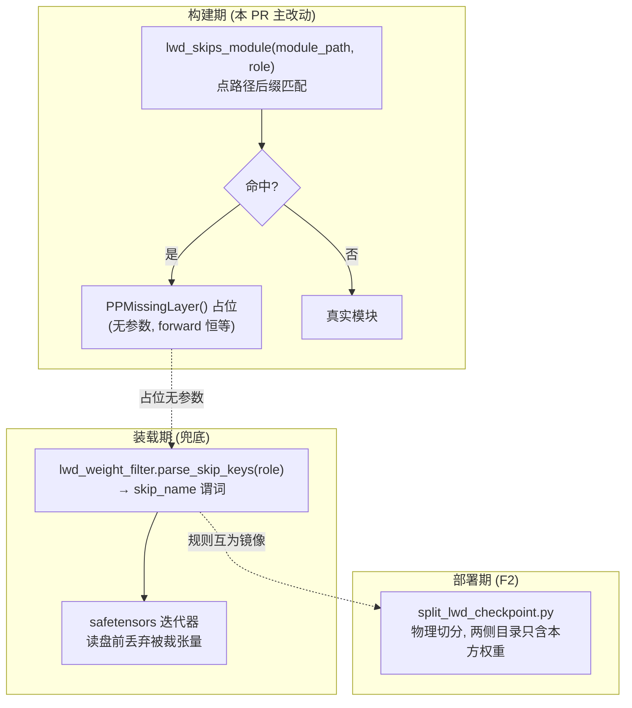

# F1: LWD 按角色裁剪模块 (module skip by role)

> RFC issue: #TBD. 上游总览: [lwd_migration_overview.md](lwd_migration_overview.md).
> 决策点 D1/D2/D3/D4 见总览 §5, 本文按建议方案展开.

## 1. 目标

prefill_only 形态下, 按进程角色在**构建期**裁掉不属于本方的模块, 并在**装载期**提供完整 checkpoint 场景的兜底过滤:

| 模块 (点路径) | edge | cloud | 依据 |
| --- | --- | --- | --- |
| `model.embed_tokens` | 保留 | 保留 | 边是嵌入入口; 云 decode 也要嵌新 token |
| `lm_head` | 保留 | 保留 | 边 rank-replay 回放 (unembed); 云采样 + 秩编码 |
| `layers.*` | 占位 | 保留 | 已由 `make_layers` LWD 分支覆盖 (edge → 0 层) |
| `model.norm` | **裁掉** | 保留 | 云侧 norm 后 hidden 下行, 边只过 lm_head (决策 D2) |
| `visual` 塔 | 保留 | **裁掉** | 多模态编码只在边; 云被喂边算好的嵌入 |
| `mtp.*` / drafter | 占位 | 保留 | drafter 在云 |

层段裁剪**不需要新做**: `vllm/model_executor/models/utils.py::make_layers` 现有 LWD 分支 (`lwd_config.role == "edge"` → `start_layer = end_layer = 0`) 已等价老代码 `(0,0)` 切分. 本特性只补**点模块级**裁剪: norm 与 visual.

## 2. 机制: 三层防漏



"不构建"强于"不加载": `PPMissingLayer` 不进 `named_parameters()`, 因此:

- 从本方**切片目录**启动: loader 不会因参数缺权重而拒绝;
- 从**完整 checkpoint** 启动: 装载期过滤兜底 (PR2);
- 误用**对方切片**: 加载期即失败 (占位模块无参数), fail-fast.

## 3. 落点与改法

### 3.1 新增 `lwd_skips_module` (决策 D1: 纯函数, 不搬老配置类)

位置: `vllm/model_executor/models/utils.py` (与 `make_layers` 同文件) 或 `vllm/config/lwd/` 新模块, 评审定. 签名:

```python
def lwd_skips_module(module_path: str, lwd_cfg: LwdConfig) -> bool:
    """True if the LWD role must NOT build this module (placeholder instead)."""
```

规则表 (prefill_only 形态, 从 `lwd_cfg.role` 推导):

- edge: 命中后缀 `norm` → skip (其余 norm 家族如 `model.norm` 由后缀覆盖).
- cloud: 命中前缀 `visual` → skip.

**必须用点路径后缀/前缀匹配, 禁止裸属性名相等** — 反例: Qwen3-VL 的 `visual.merger.norm` 含 `norm` 子路径, 但归属 visual 塔, 只能被 cloud 的 visual 规则裁, 不能被 edge 的 norm 规则误伤. 老代码已有该测试用例, 一并迁入.

### 3.2 模型守卫 5 处 (目标仓现状: 全无守卫, 均有构建条件可挂)

| 文件 | 位置 | 现状条件 | 改法 |
| --- | --- | --- | --- |
| `vllm/model_executor/models/deepseek_v2.py` | final norm 构建 (~L1481) | `is_last_rank` | `and not lwd_skips_module(..., "norm")`; 连带覆盖 GLM-5.x 系 |
| `vllm/model_executor/models/qwen3_5.py` | norm (~L269) | 原生条件 | 同上 |
| `vllm/model_executor/models/qwen3_5.py` | visual (~L513, ~L732) | `_mark_tower_model` 上下文内 | `and not lwd_skips_module(..., "visual")` |
| `vllm/model_executor/models/qwen3_vl.py` | visual (~L1862) | `_mark_tower_model` 上下文内 | 同上 |

注意: `_mark_tower_model` / `StageMissingLayer` (interfaces.py) 的既有跳塔通道由 `limit_mm_per_prompt=0` 触发, 语义是"无多模态请求", 与"角色裁剪"不同 — **不要复用该通道表达角色**, 否则 F2 镜像规则与运行时行为对不上. 角色裁剪直接在构建条件处加守卫.

### 3.3 决策 D2 联动项: norm 归属核验

老设计: 云侧 forward 末尾 norm → lm_head → 采样 → 秩编码; 下行 hidden 已 norm; 边侧 unembed 只过 lm_head. 若边侧保留 norm 并在回放时施加, 会双重 norm.

实施 PR1 前必须确认本仓边侧 `LwdUnembedBatch` → logits 路径是否调用 `model.norm`. 若调用, 采老语义 (边裁 norm) 需同步确认云侧下行 hidden 已 norm; 若本仓回放路径本就绕过 norm, 则 D2 可改为"边侧保留 norm 但不使用", F2 的 `norm.*` 规则随之调整. **结论写入 PR 描述.**

### 3.4 决策 D3 联动项: 云侧多模态关闭

模型侧由 visual 裁剪表达; processor 侧在 lwd 云引擎 bootstrap 处跳过 mm processor 初始化 (云不被喂 mm items, 切片也无 processor 文件). 不引入 `mm_encoder_remote` 之类的近义词.

## 4. 装载期兜底 (PR2)

1. 新建 `vllm/model_executor/model_loader/lwd_weight_filter.py` (决策 D4, 镜像 `ep_weight_filter.py` 形态):
   - `parse_skip_keys(lwd_cfg) -> set[str]`: 从角色推导被裁模块的点路径键集合;
   - `name_is_skipped(name: str, skip_keys) -> bool`: 与构建期同一套后缀/前缀匹配逻辑 (抽公共实现, 两处引用同一函数, 禁止复制两份).
2. `vllm/model_executor/model_loader/default_loader.py::_get_weights_iterator` (~L244) 增加 `skip_name: Callable[[str], bool] | None` 形参, 组装处 `lwd_config is not None` 时注入谓词.
3. `vllm/model_executor/model_loader/weight_utils.py::safetensors_weights_iterator` (~L866) 透传 `skip_name`, 在读盘前 `continue` — 命中即不产生磁盘读.

启用条件用 `lwd_config is not None` (本仓无 `enabled` 字段; 老代码的 `enabled` 语义由拓扑存在性表达).

## 5. 明确不迁 (老代码裁剪相关)

- `vllm/config/lwd.py` 老行为配置类整体 (`enabled`/`mode`/`local_layer_indices`).
- `make_lwd_layers` 非连续层段 (head/tail), `set_edge_cloud_layer_range` 全套.
- pp=2 / 首尾 rank 改写 / `not enable_lwd` PP 守卫.

## 6. 单测清单

- `lwd_skips_module` 后缀匹配: `model.norm` 命中 edge 规则; `visual.merger.norm` 不命中 edge 的 norm 规则 (反例); `visual` 命中 cloud 规则; 空 `lwd_config` / 非 LWD 恒 False.
- 构建期: edge 角色下模型图不含 norm 参数 (`named_parameters` 无 `norm`); cloud 角色下不含 visual 参数.
- 装载期: 完整 checkpoint + 过滤器加载后 `named_parameters` 与切片 checkpoint 加载结果一致; 被裁张量无磁盘读 (可用计数迭代器断言).
- 失败分支: 误用对方切片目录 → 加载期报缺权重, fail-fast.
