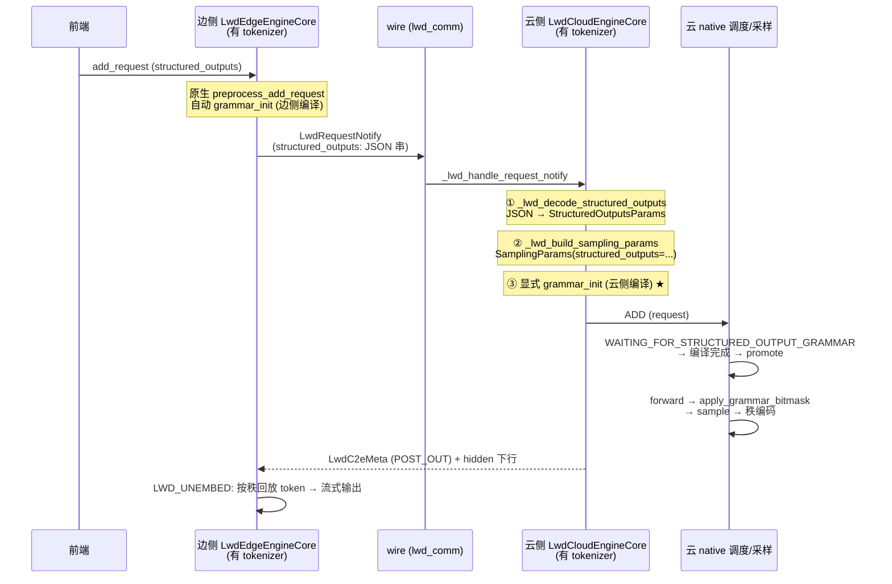

# F3: LWD 结构化输出迁移 (structured output over edge-cloud)

> RFC issue: #TBD. 上游总览: [lwd_migration_overview.md](lwd_migration_overview.md).
> 前置: [lwd_weight_split.md](lwd_weight_split.md) §5 (云侧切片须含 tokenizer).

## 1. 原理: 生效点 = 采样点

结构化输出的文法编译 (grammar compile) 与采样 bitmask 施加都发生在**采样所在侧**. LWD 是 rank-replay 架构: **云侧采样 + 秩编码, 边侧按秩用自己的 lm_head 回放 token**. 因此:

- bitmask 在**云侧**采样前施加 → 云侧必须有 tokenizer (编译) 与 `StructuredOutputManager`;
- 约束必须随请求**上 wire** (边侧准入后传云);
- 边侧同样编译一份文法, 仅用于 picker 过滤 (§5), 不产 bitmask.

数据面零改动: bitmask 只影响云侧采样结果, 秩编码/回放链路 (`LwdC2eMeta`, `top_id_ths`) 不感知约束存在.

## 2. 端到端时序



★ = 两处正确性关键, 老代码踩过的坑, 见 §5.

## 3. 接缝改动清单 (7 处)

### 3.1 消息结构: `vllm/v1/lwd_control/lwd_comm/lwd_messages.py`

- `LwdRequestNotify` (msgspec.Struct, ~L52) 追加字段:

  ```python
  structured_outputs: str = ""   # JSON 串; 空 = 普通请求
  ```

- `LWD_MESSAGE_VERSION` 3 → **4** (~L17). 握手校验在 `lwd_handshake.py` (~L135) 自动拦截新旧混部.
- 遵守该文件 docstring 的兼容纪律: **只允许追加带默认值字段, 否则 bump 版本**. 旧云 + 新边 = 版本不符握手失败 (比老代码 wire v5 的"静默丢字段"更强, 保留本仓行为).
- 序列化: `StructuredOutputsParams` 经 `dataclasses.asdict` + `json.dumps`; `_backend` 等私有字段单独处理 (asdict 前 pop, 反序列化后回填), 不进 JSON.

### 3.2 边侧组包: `lwd_edge_engine.py::_lwd_notify_request` (~L303)

在现有 `LWD_SAMPLING_FIELDS` 逐字段打包处, 追加 `structured_outputs` 的序列化 (复用 3.1 的编码函数, 单一实现).

### 3.3 边侧准入: `lwd_edge_scheduler.py::_lwd_validate_request` (~L972)

删除现有拒绝块:

```python
if request.use_structured_output:
    raise ValueError("[LWD] prefill-only mode does not support structured output ...")
```

改为放行 (可选: 校验约束类型在支持列表内, 不支持则 fail-fast 报错文案指明).

### 3.4 云侧重建: `lwd_cloud_engine.py::_lwd_build_sampling_params` (~L608)

解析 `structured_outputs` JSON → `StructuredOutputsParams` (私有字段回填) → 构造 `SamplingParams(structured_outputs=...)`, 走现有 `update_from_generation_config` 流程. 解析失败 fail-fast: 报错并携带 req_id 与原始串, 不允许半解析请求入队.

### 3.5 云侧显式 grammar_init ★: `lwd_cloud_engine.py::_lwd_handle_request_notify` (~L444)

在 `input_queue.put_nowait((ADD, ...))` (~L466) **之前**插入:

```python
self.structured_output_manager.grammar_init(request)
```

理由: LWD 云侧 Request 是 wire 重建的自建对象, **绕过**了原生自动编译入口 `v1/engine/core.py::preprocess_add_request` (~L995, 仅对 `req.use_structured_output` 触发). 漏掉此调用 → 云侧请求永久滞留 `WAITING_FOR_STRUCTURED_OUTPUT_GRAMMAR`, 无报错静默卡死. `structured_output_manager` 已在 `EngineCoreProc.__init__` 创建, 无需新建.

### 3.6 云侧启动 fail-fast: tokenizer 强制

云侧 LWD 启动时若 `skip_tokenizer_init=True` → 直接报错中止 (不等到第一个结构化请求才崩).

依据: `v1/structured_output/__init__.py` (~L71-81) 仅在 `not skip_tokenizer_init` 时创建 tokenizer + 编译线程池, 否则 `grammar_init` 运行期崩溃 — 启动期拦截符合团队 fail-fast 规范, 替代老代码"不强制 skip"的消极处理.

### 3.7 边 picker 的 grammar-ready 过滤 ★

- 位置: 候选扫描在 `lwd_edge_scheduler.py` (~L498-539, `[*self.skipped_waiting, *self.waiting]`), picker 纯函数 `lwd_edge_picker.py::lwd_pick_prefill_batch` (~L30).
- 改法: 候选集中过滤掉 `use_structured_output` 且边侧文法未编译完成的请求 — 判据读 `request.structured_output_request.grammar` future 是否 ready (**只读, 不抢状态提升**, 避免与原生 promote 竞态).
- 理由: 云侧 native 调度对编译中请求是 defer 语义 (`WAITING_FOR_STRUCTURED_OUTPUT_GRAMMAR` → `skipped_waiting`, 编译完成经 `_try_promote_blocked_waiting_request` 转 waiting). 若边 picker 先选中而云侧 defer, 两侧执行集不一致. 老代码曾以步后 `got != want` RuntimeError 核验兜住此问题; 本仓一致性靠 visible-set (`_lwd_schedule`), 无步后核验, **必须靠前置过滤保证**.

边侧编译来源: 边侧请求走原生 `preprocess_add_request` 自动 `grammar_init` (边有 tokenizer, `EngineCoreProc` 链路不变), 无需额外改动.

## 4. 已具备、零改动

- 批型 `LwdBatchType / LwdEmbedBatch / LwdUnembedBatch` (`v1/core/sched/output.py`).
- rank-replay 数据面: `LwdC2eMeta` 组包、`top_id_ths` 切分、边侧回放 (`lwd_cloud_scheduler.py` / `lwd_edge_scheduler.py`).
- 云 bitmask 链路: `get_grammar_bitmask` (engine/core.py) → `apply_grammar_bitmask` (gpu_model_runner.py ~L4596) → `_sample`; 云引擎 step 走 `super()` 自动继承.
- `RequestStatus.WAITING_FOR_STRUCTURED_OUTPUT_GRAMMAR` 状态机与 native promote.
- 多 DP 台账 `LwdCloudDpAccount`、executor 代理 — 不触碰.

## 5. 正确性风险登记 (评审重点)

| 风险 | 后果 | 防线 |
| --- | --- | --- |
| 云侧漏显式 `grammar_init` (§3.5) | 请求永久滞留 WAITING 状态, 无报错 | 代码评审 + 单测断言 ADD 前必调; 集成测试用带约束请求压一个 eval 周期 |
| 边 picker 漏 grammar-ready 过滤 (§3.7) | 边云执行集不一致 → 死等/乱序 | 代码评审 + 临时一致性日志 (本仓无步后核验, 观察一个 eval 周期后决定是否固化核验) |
| 版本未 bump (§3.1) | 新旧混部静默丢字段 | 握手版本校验单测: v3 云 + v4 边必须拒绝 |
| JSON 私有字段泄漏 (§3.1/3.4) | `_backend` 序列化失败或云侧反序列化错 | roundtrip 单测覆盖含 `_backend` 的对象 |
| 云侧无 tokenizer 运行 (§3.6) | 首个结构化请求运行期崩溃 | 启动 fail-fast + 切片 METADATA_RULES (F2 §5) |

## 6. 验证清单

- 单测: 序列化 roundtrip (含私有字段); `LWD_MESSAGE_VERSION` 不匹配握手拒绝; picker 过滤的三个分支 (无约束 / 约束未就绪 / 约束就绪).
- ST: json_schema 约束请求端到端 — 边准入 → wire → 云编译 → bitmask 采样 → 秩回放, 输出 token 全程满足 schema (用约束校验器断言, 不靠肉眼).
- 一致性: 并发混合 (约束 + 普通请求) 下, 边 picker 选中集与云 native 执行集逐 step 比对 (临时日志), 一个 eval 周期无 diff 后移除日志.
