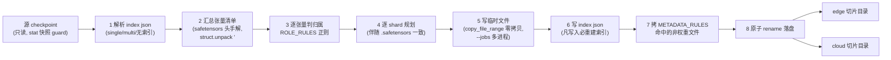

# F2: LWD 权重划分 (checkpoint split by role)

> RFC issue: #TBD. 上游总览: [lwd_migration_overview.md](lwd_migration_overview.md).
> 前置: [lwd_role_module_skip.md](lwd_role_module_skip.md) (规则互为镜像).

## 1. 目标

提供离线工具 `scripts/lwd/split_lwd_checkpoint.py`: 把一个完整 HF checkpoint 物理切分为 edge 与 cloud 两个自洽目录, 两侧各自只含本方运行所需权重与元数据. 作用:

1. 边侧目录小 (embed + lm_head + visual), 适配边端存储;
2. 云侧目录不含 visual/processor, 部署面收窄;
3. 与 F1 镜像: 两侧从本方目录启动时, 模型图 (裁剪后) 与目录内容恰好一致.

老代码脚本**整体迁入**, 纯 Python 标准库、零 vLLM 依赖, 无适配成本; 仅规则表按本仓决策 (D2/D3) 校订.

## 2. 为什么必须按张量切 (而不是按文件)

HF 分片 (shard) 是按张量名交错打包的: 同一个 shard 里既有 `layers.0.*` 也有 `layers.57.*`、`norm.*`、`visual.*`. 按文件拷贝无法得到角色纯净的目录, 必须以**张量名为最小单位**筛选重排.

## 3. 流水线 (迁入后保持不变)



工程纪律 (老代码已具备, 迁入时保留):

- **确定性**: 全程 sorted, 两次切分逐字节一致;
- **原子性**: 临时名 + `os.replace`, 失败不留半成品;
- **只读 guard**: 记录源目录 stat 快照, 切分中源被改即中止;
- **索引陷阱**: 单 shard + 伴随 safetensors (`xxx.rot.safetensors` 之类) 的目录, 只要写入了张量就必须重写 index, 否则 loader 看到旧索引;
- 退出码 0-6 区分失败类别, 供 CI 消费.

## 4. ROLE_RULES (按本仓决策校订)

| 张量名模式 | edge | cloud | 说明 |
| --- | --- | --- | --- |
| `embed` / `embed_tokens` | 保留 | 保留 | 边嵌入入口; 云 decode 嵌新 token |
| `lm_head` | 保留 | 保留 | **rank-replay 前提**: 边 unembed 回放、云采样+秩编码各需一份 |
| `layers.*` | 丢弃 | 保留 | 与 `make_layers` LWD 分支镜像 |
| `norm.*` | **按 D2** | 保留 | 若 F1 采"边裁 norm", edge 丢弃; 见 F1 文档 §3.3 |
| `visual.*` | 保留 | 丢弃 | 多模态编码只在边 |
| `mtp.*` / draft | 丢弃 | 保留 | drafter 在云 |
| `tid2eid` | 保留 (正则特例) | layers 规则覆盖 | 边虽不建层, vllm-ascend 按路径直接读 (Hash MoE 路由表) |
| 其余 | **报错** | **报错** | fail-fast: 规则未覆盖的张量必须显式归类后才能放行 |

**镜像纪律**: 本表与 F1 的 `lwd_skips_module` 规则同源 (同一份规则表推导两侧), 改一侧必须审计另一侧, 两处放同一评审周期. 老代码的实现方式是脚本内置规则表与运行时 `parse_skip_keys` 共享语义 — 迁入时保持"单一事实源": 脚本可 import `lwd_weight_filter.parse_skip_keys` (允许脚本依赖 vllm 包, 作为可选路径; 无 vllm 环境时退回内置表并校验一致性), 或直接复制并在两处单测里断言等价. 二选一由评审定, 不允许静默漂移.

## 5. METADATA_RULES

| 角色 | 规则 |
| --- | --- |
| cloud 最小集 | `config.json` + **tokenizer 全家桶** (`tokenizer.json`/`tokenizer_config.json`/`special_tokens_map.json`/`vocab.*`/`merges.*`) + `chat_template` 相关 |
| cloud 不拷 | processor 文件 (`preprocessor_config.json` 等) — 云不建 processor (F1 D3) |
| edge | `("*", "optional")` 全拷 — 边是对外服务前端, tokenizer/processor 都要 |

**tokenizer 全家桶进云侧切片是 F3 的硬前提**: `StructuredOutputManager` 仅在带 tokenizer 时创建编译线程池, 云侧 grammar_init 依赖它. 本规则先落 (PR3), F3 (PR4) 才能跑通.

## 6. 与部署拓扑的关系

本仓 `tools/gen_lwd_topology.py` 生成拓扑配置, 但不含切片目录概念. 部署文档需补充对应关系:

```text
topology (gen_lwd_topology.py)          checkpoint 切片 (split_lwd_checkpoint.py)
  edge 实例  ──────────────────────────  edge_dir   (embed+lm_head+visual+tid2eid)
  cloud 实例 ──────────────────────────  cloud_dir  (layers+norm+mtp+lm_head+tokenizer)
```

两侧启动时 `--model <本方切片目录>`, 拓扑照常指向对端.

## 7. 单测与验证

- 规则覆盖: 对 Qwen3-VL / DeepSeek-V4 风格的合成 index, 断言每个张量恰好归属一侧 (或显式报错), 输出覆盖报告;
- 确定性: 同源两次切分, 目录 diff 为空;
- 只读 guard: 切分中 touch 源目录 → 中止并退出码非 0;
- 索引陷阱: 构造单 shard + 伴随 safetensors 的目录, 断言 index 被重写且张量集正确;
- 端到端 (ST): edge 从 edge_dir、cloud 从 cloud_dir 各自启动成功; 交换目录 → 加载期失败.
